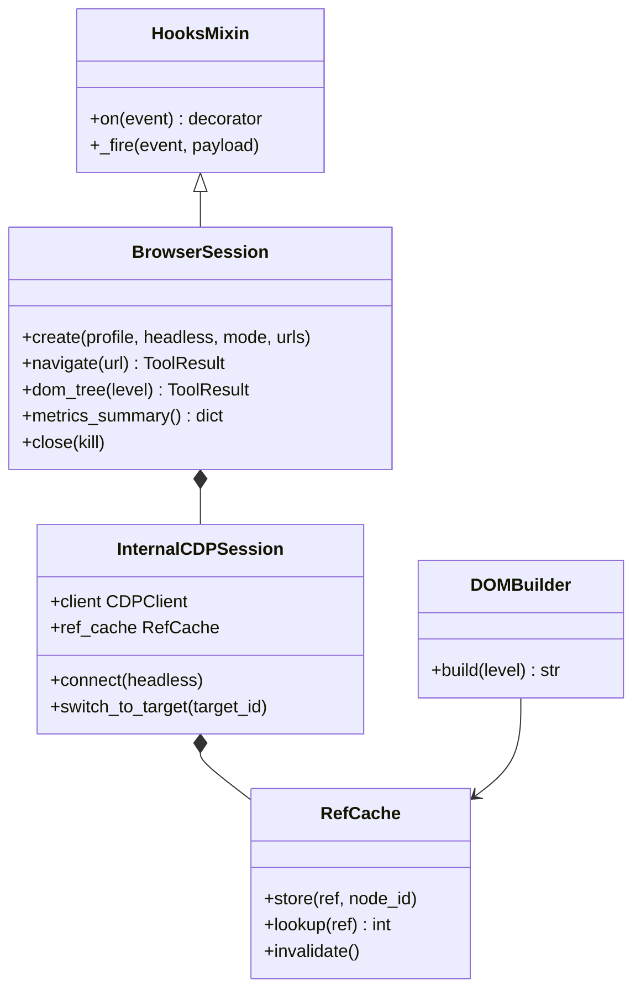

# 浏览器动作核心引擎组件

`BrowserSession` 是面向调用方的异步 API 门面：把 19 个动作统一包装成 `before_action → 动作体 → _record` 的洋葱链，并把 DOM 快照、元素 ref、CDP 客户端三类状态收拢在 `_InternalCDPSession` 中。底层传输委托 [`cdp-layer.md`](cdp-layer.md)，动作级动词字典见 [`../contracts/api/python-api.md`](../contracts/api/python-api.md)。

## 1. 引擎级硬不变量

1. **动作包络不变量**：每个公开动作必须 `_fire("before_action")` → 调用动作实现 → `_record(result)`，`_record` 再发 `after_action` 或 `action_error`（`src/octop_browser/session.py:895-903`）。
2. **导航清 ref 不变量**：`navigate/go_back/go_forward/reload` 四个动作第一步都是 `ref_cache.invalidate()`（`src/octop_browser/actions/navigate.py:25-28,60-87`），新增导航类动作必须照做。
3. **token 估算不变量**：文本类内容统一 `len(content) // 4`（`src/octop_browser/session.py:327`、`src/octop_browser/actions/js_eval.py:49`），不得改用其他估算公式。
4. **ref 必须来自实时快照**：`click/type/fill/hover/select` 先经 `RefCache.lookup()`，未找到时抛 `CDPSessionError("Ref '...' not found. Call dom_tree() first.")`（`src/octop_browser/actions/interact.py:32-60`）。
5. **截图返回路径而非 base64**：`Page.captureScreenshot` 的 `data` 经 base64 解码后写盘，`content` 只返回文件路径（`src/octop_browser/actions/capture.py:170-187`）。

## 2. 核心类型层次与职责



| 核心符号 | 源码锚点 | 持有状态 | 生命周期 |
|---|---|---|---|
| `BrowserSession` | `src/octop_browser/session.py:174-196` | `_action_count`, `_total_duration_ms`, `_total_tokens`, `_errors` | 一次会话，复用期间累计指标 |
| `_InternalCDPSession` | `src/octop_browser/session.py:33-47` | 一个 `CDPClient` + 一个 `RefCache` + 空闲控制器 | 每个页面一个，切标签时重建客户端 |
| `DOMBuilder` | `src/octop_browser/dom/builder.py:137-184` | CDP DOM 根节点、url、title、ref 缓存引用 | 每次 `dom_tree()` 临时创建 |
| `HooksMixin` | `src/octop_browser/hooks.py:19-53` | `_hooks` 字典，四个合法事件 | 混入 `BrowserSession` |
| `RefCache` | `src/octop_browser/dom/refs.py:6-29` | `ref → nodeId` 字典 | 与页面同生命周期，导航清空 |

## 3. 启动装配与 DOM 管线调用树

```text
BrowserSession.create() -> src/octop_browser/session.py:198-250
  ├─ pm.get_or_create(profile) -> profile 与 CDP 端口 : :228
  ├─ headless 优先级: 显式 headless > 显式 mode > cfg.browser_mode : :231-235
  ├─ internal.connect(headless) -> :236-237（详见 cdp-layer.md）
  └─ [if urls] 第一个 URL 走 navigate，其余走 new_tab(force_new=True) : :241-248

BrowserSession.dom_tree(level) -> src/octop_browser/session.py:300-346
  ├─ CDP DOM.getDocument(depth=-1) -> doc["root"] : :306-307
  ├─ Runtime.evaluate 取 location.href / document.title : :308-319
  ├─ DOMBuilder.build(level)  Walks DOM + 写 ref : :320-326
  │    ├─ [tag/role 命中交互集合] _make_ref + ref_cache.store : src/octop_browser/dom/builder.py:223-230
  │    └─ [iframe/shadowRoots/contentDocument] 递归下钻 : :264-296
  └─ ToolResult(content, metrics.estimated_tokens = len // 4) : :327-334
```

交互标签集合与结构标签集合分别定义在 `src/octop_browser/dom/builder.py:12-32`；`a` 标签无 `href` 不计入交互（`src/octop_browser/dom/builder.py:224-226`）；跳过 `script/style/svg/head` 等噪声标签但仍递归 `#document`（`src/octop_browser/dom/builder.py:48-61,200-215`）。

## 4. 动作扇出与 CDP 命令字典

| 动作 | 主实现（`路径:行号`） | 关键 CDP 命令与请求字典键 | 成功/失败判定 |
|---|---|---|---|
| `navigate` | `src/octop_browser/actions/navigate.py:25-57` | `Page.navigate {"url"}`，等 `Page.loadEventFired` 最多 5 秒 | `errorText` 非空即失败；加载超时被吞掉仍成功 |
| `dom_tree` | `src/octop_browser/session.py:300-346` | `DOM.getDocument {"depth": -1}`、`Runtime.evaluate {"expression","returnByValue"}` | 异常兜底为 `success=False` |
| `screenshot` | `src/octop_browser/actions/capture.py:87-228` | `Page.captureScreenshot {"format","clip","captureBeyondViewport"}`，裁剪用 `DOM.getBoxModel` / `Page.getLayoutMetrics` | `data` 为空即失败；element_ref 优先于 full_page |
| `click` | `src/octop_browser/actions/interact.py:63-89` | 两次 `Input.dispatchMouseEvent {"type","x","y","button","clickCount"}` | 坐标解析失败抛异常 |
| `type` / `fill` | `src/octop_browser/actions/interact.py:92-109,167-203` | 逐字符 `Input.dispatchKeyEvent {"type":"char","text"}`；fill 先发 Ctrl+A/Meta+A + Backspace | 先 click 目标再逐字符输入 |
| `select` | `src/octop_browser/actions/interact.py:226-273` | `DOM.resolveNode` + `Runtime.callFunctionOn {"objectId","functionDeclaration","arguments"}` 或 `Runtime.evaluate` | 同时派发 `input` 与 `change` 事件 |
| `wait` | `src/octop_browser/session.py:491-557` | 轮询 `Runtime.evaluate` 取 url/text/selector，步长 0.25 秒 | 默认 `timeout_ms=10000`，超时返回失败 |
| `eval_js` | `src/octop_browser/actions/js_eval.py:12-59` | `Runtime.evaluate {"expression","returnByValue":true,"awaitPromise":true}` | 返回 `subtype=="error"` 即失败 |

`scroll` 固定从 `(400, 300)` 发 `mouseWheel`（`src/octop_browser/actions/interact.py:124-133`）；`press` 的 `code` 仅对 Enter/Tab/Escape/Backspace 做映射（`src/octop_browser/actions/interact.py:206-223`）。跨标签动作通过 `_InternalCDPSession.switch_to_target()` 重建连接（`src/octop_browser/session.py:98-147`）。

## 5. 共变耦合与修改清单

- **新增动作**：改 `src/octop_browser/session.py` 增加方法 → 同步 `_KNOWN_ACTIONS`（`src/octop_browser/tool_interface.py:20-43`）→ CLI `_ACTION_ALIAS`/`_action_kwargs`（`src/octop_browser/cli.py:413-499`）→ MCP `_TOOLS`/`_ACTION_MAP`（`src/octop_browser/mcp_server.py:24-364`）→ `contracts/api-reference.md`。
- **改 DOM 输出结构**：回放侧解析 `elements` 数组（`src/octop_browser/record/matcher.py:13-16`），结构变更会同时破坏匹配与 Skill 生成，必须跑 `tests/unit/test_dom_builder.py`、`tests/unit/test_record_replay_replay_runner.py`。
- **改导航类动作**：必须保留 `ref_cache.invalidate()`，否则乘法语义下旧 nodeId 会被复用；跑 `tests/unit/test_navigate_actions.py`、`tests/integration/test_session.py`。
- **改 hook 语义**：异常只记日志不影响动作（`src/octop_browser/hooks.py:45-53`），跑 `tests/unit/test_hooks.py`。
