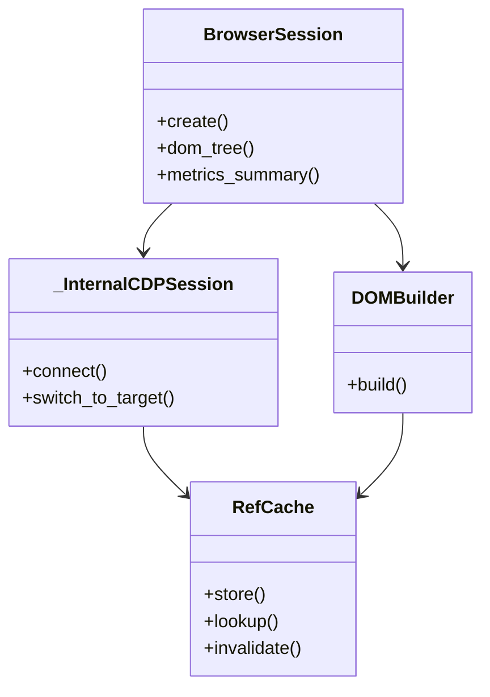

# 浏览器会话与 DOM 引用引擎（核心领域引擎）

`BrowserSession`（`src/octop_browser/session.py:174`）是公开异步门面，混入 `HooksMixin` 并累计 `metrics_summary()`；`_InternalCDPSession`（`:33`）持有单个 `CDPClient` 与单个 `RefCache`。`DOMBuilder` 把 `DOM.getDocument` 快照编译成四档 token 友好文本并签发稳定 ref，动作层用 ref 反查 `nodeId` 后通过 `Input.dispatch*` 驱动 Chrome。引擎级不变量是「导航即失效 ref」与「动作统一返回 `ToolResult`」。

## 1. 引擎核心不变量（Hard Invariants）

1. **导航失效不变量**：`navigate/go_back/go_forward/reload` 与 `switch_to_target` 均调用 `RefCache.invalidate()`（`src/octop_browser/actions/navigate.py:28`、`src/octop_browser/session.py:141`）；任何新增导航类动作若不失效缓存，会把过期 `nodeId` 交给 Agent（`src/octop_browser/dom/refs.py:23`）。
2. **统一返回与失败闭合不变量**：每个动作经 `_record` 累计计数与错误，成功后 `_fire("after_action", metrics)`，失败后 `_fire("action_error", result)`（`src/octop_browser/session.py:895`）；`browser_tool` 对所有异常兜底为 `ToolResult(success=False, error=...)`（`src/octop_browser/tool_interface.py:211`）。
3. **token 估算不变量**：文本类内容的 `estimated_tokens = len(content) // 4`（`src/octop_browser/session.py:327`），新增生成正文的动作必须沿用同一口径。
4. **CDP 域最小使能不变量**：连接后仅 `enable_domain("Page"/"DOM"/"Runtime")`（`src/octop_browser/session.py:64`），`Input` 域无 `enable` 方法，事件直接 `dispatch`（`src/octop_browser/session.py:67`）。

## 2. 核心类型层次与职责表



| 核心符号 | 源码锚点 | 持有的关键状态 | 职责与生命周期 |
|---|---|---|---|
| `BrowserSession` | `src/octop_browser/session.py:174` | `_action_count`、`_total_duration_ms`、`_total_tokens`、`_errors` | 每 profile 一个实例，`__aenter__/__aexit__` 收尾 |
| `_InternalCDPSession` | `src/octop_browser/session.py:33` | `_client`、`_ref_cache`、`_idle_controller`、`_connected` | 一个页面一条 CDP WebSocket |
| `DOMBuilder` | `src/octop_browser/dom/builder.py:137` | `_dom`、`_url`、`_title`、`_ref_cache` | 单次 `dom_tree` 即时构造 |
| `RefCache` | `src/octop_browser/dom/refs.py:6` | `_refs` 字典（ref → nodeId） | 会话内长期持有，导航清空 |
| `BrowserIdleController` | `src/octop_browser/idle.py:22` | `_last_activity`、`_active_commands`、`_reaped` | 按 `(data_dir, host, port)` 共享的守护任务 |
| `HooksMixin` | `src/octop_browser/hooks.py:19` | `_hooks` 四类事件回调表 | `page_navigated` 仅注册不触发（`src/octop_browser/hooks.py:33`） |

## 3. 核心处理管线与关键阈值

```text
BrowserSession.create() (src/octop_browser/session.py:198)
  ├─ [Stage 1 模式解析] headless 显式 > mode 参数 > cfg.browser_mode (src/octop_browser/session.py:231)
  ├─ [Stage 2 连接] _InternalCDPSession.connect (src/octop_browser/session.py:49)
  │    ├─ [if cfg.cdp_ws_url] 直连远端，跳过 launcher (src/octop_browser/session.py:55)
  │    └─ [else] launch_or_attach 加 get_page_ws_url (src/octop_browser/session.py:59)
  ├─ [Stage 3 视口] Emulation.setDeviceMetricsOverride(width,height,deviceScaleFactor=1,mobile=False) (src/octop_browser/session.py:86)
  └─ [Stage 4 使能] Page / DOM / Runtime (src/octop_browser/session.py:64)

dom_tree(level) (src/octop_browser/session.py:300)
  ├─ DOM.getDocument {"depth": -1} -> root (src/octop_browser/session.py:306)
  ├─ Runtime.evaluate {"expression": "...location.href...", "returnByValue": True} -> url/title (src/octop_browser/session.py:308)
  ├─ DOMBuilder.build(level) (src/octop_browser/dom/builder.py:160) -> 四档文本
  └─ tokens = len(content) // 4 (src/octop_browser/session.py:327)

click(ref) -> interact.click (src/octop_browser/actions/interact.py:63)
  ├─ _resolve_coords: ref -> RefCache.lookup -> DOM.getBoxModel -> 中心点 (src/octop_browser/actions/interact.py:41)
  │    └─ ref 缺失 -> CDPSessionError("Ref not found. Call dom_tree() first.") (src/octop_browser/actions/interact.py:44)
  └─ Input.dispatchMouseEvent 两次 mousePressed/mouseReleased (src/octop_browser/actions/interact.py:74)
```

| 关键常量 / 阈值 | 代码值 | 源码位置 | 作用 |
|---|---|---|---|
| `_LOAD_EVENT_TIMEOUT_SECONDS` | `5.0` | `src/octop_browser/actions/navigate.py:13` | 等 `Page.loadEventFired` 上限，超时不判失败 |
| `_CHECK_INTERVAL_SECONDS` | `60.0` | `src/octop_browser/idle.py:17` | 空闲巡检周期上限 |
| `wait` 默认 `timeout_ms` | `10000` | `src/octop_browser/session.py:496` | 条件等待循环，步长 `0.25s`（`src/octop_browser/session.py:544`） |
| `estimated_tokens` 口径 | `len(content) // 4` | `src/octop_browser/session.py:327` | 全站 token 估算统一公式 |
| `_REUSABLE_BLANK_URLS` | `about:blank` 等 3 个 | `src/octop_browser/session.py:30` | `new_tab` 复用空白标签判定 |
| `scroll` 默认 `amount` | `300` | `src/octop_browser/actions/interact.py:116` | `deltaY` 像素量 |
| `_subtree_text` 截断 | `300` 字符 | `src/octop_browser/dom/builder.py:80` | 单节点子树文本上限 |

## 4. 共变耦合与扩展清单（Agent Co-Change Playbook）

- **新增动作**：`BrowserSession` 加方法 (`src/octop_browser/session.py:262`) → `_KNOWN_ACTIONS` (`src/octop_browser/tool_interface.py:20`) → CLI `_ACTION_ALIAS` 与 `_action_kwargs` (`src/octop_browser/cli.py:413`) → MCP `_TOOLS` 与 `_ACTION_MAP` (`src/octop_browser/mcp_server.py:24`) → 本页阈值表与 [业务流程总表](../business/index.md)。
- **新增导航类动作**：必须显式 `ref_cache.invalidate()`，并核对 `switch_to_target` 的重建路径 (`src/octop_browser/session.py:141`)。
- **修改 DOM 层级**：`DOMBuilder.build` 分支 (`src/octop_browser/dom/builder.py:176`) 与 `_make_ref` 前缀表 (`src/octop_browser/dom/builder.py:124`) 同步，且回放侧 `match_target` 依赖 `structured` 输出的 `elements` 数组 (`src/octop_browser/record/matcher.py:13`)。
- **必跑回归**：`pytest tests/unit/test_dom_builder.py tests/unit/test_refs.py tests/unit/test_tool_interface.py tests/unit/test_navigate_actions.py`，映射见 [构建与单测映射](../operations/dev-and-test.md)。
