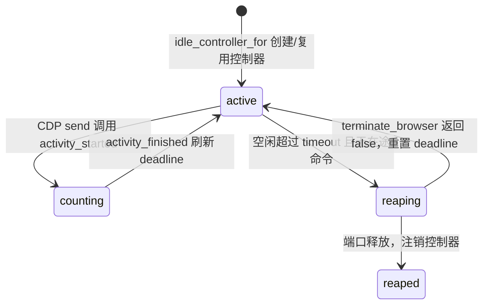

# CDP 传输与 Chrome 进程底座组件

本层封装唯一的出向通信底座：WebSocket 帧级 CDP 客户端、Chrome 进程启动/重连/终止、profile 目录与端口分配、空闲回收。禁止在本层拼装业务动作语义（动作字典在 [`browser-engine.md`](browser-engine.md)，出向字典契约在 [`../integrations/downstream/chrome-cdp.md`](../integrations/downstream/chrome-cdp.md)）。

## 1. 组件硬边界与不变量

1. **单连接单页面不变量**：一个 `CDPClient` 只绑定一个 page target；切标签必须 `close()` 后重建客户端并清空 ref（`src/octop_browser/session.py:136-147`）。
2. **CDP 帧协议闭合**：所有命令经 `send(method, params)` 编码为 `{"id", "method", "params"}`，响应以 `id` 匹配 future，`result` 内层被解包返回（`src/octop_browser/cdp/client.py:89-116`）。
3. **host 不硬编码**：所有 HTTP 探测读取 `settings.cdp_host`，仅在白名单 `localhost/127.0.0.1/::1` 时允许本地启动与终止（`src/octop_browser/cdp/launcher.py:452-455`、`src/octop_browser/idle.py:18`）。
4. **环境自愈不下沉**：XDG 目录、SingletonLock、`/root` 目录重定位统一由 `prepare_chrome_launch()` 完成，调用方不重复实现（`src/octop_browser/cdp/launch_prep.py:207-228`）。

## 2. CDP 客户端帧级契约

| 机制 | 实现细节 | 源码锚点 |
|---|---|---|
| 连接与帧大小 | `websockets.connect(ws_url, max_size=_settings.cdp_max_message_size)`，避免截图触发 1009 | `src/octop_browser/cdp/client.py:56-73` |
| 命令字典 | `{"id": msg_id, "method": method, "params": params or {}}`，`params` 为 None 时填空字典 | `src/octop_browser/cdp/client.py:91-93` |
| 超时与错误 | `asyncio.wait_for(future, timeout=self._timeout)` 超时抛 `CDPSessionError("Timeout waiting for response to ...")`；响应含 `error` 键同样抛错 | `src/octop_browser/cdp/client.py:99-114` |
| 被动探针 | `send_passive()` 置 `track_activity=False`，健康检查不刷新空闲截止时间 | `src/octop_browser/cdp/client.py:118-122` |
| 接收循环 | 后台 task 逐帧解析；带 `id` 的帧唤醒 future，带 `method` 的帧派发监听器并注入 `__client` | `src/octop_browser/cdp/client.py:152-177` |
| 断链传播 | 接收循环异常时给所有 pending future 设置 `CDPSessionError("Connection lost: ...")`，上层据此触发会话重建 | `src/octop_browser/cdp/client.py:172-177` |

## 3. Chrome 进程装配调用树

```text
_InternalCDPSession.connect(headless) -> src/octop_browser/session.py:49-72
  ├─ [if cfg.cdp_ws_url] 直连远程 WebSocket，完全跳过 launcher  -> src/octop_browser/session.py:55-57
  └─ [else] launch_or_attach(profile, headless) -> src/octop_browser/cdp/launcher.py:497-615
       ├─ [if _port_in_use] 重连现有 CDP 端口 -> _get_ws_url() : src/octop_browser/cdp/launcher.py:508-514
       ├─ [guard: 远端 host] 非 loopback 拒绝启动 -> RuntimeError : src/octop_browser/cdp/launcher.py:516-523
       ├─ find_chrome() 四级查找 -> src/octop_browser/cdp/launcher.py:150-187
       ├─ prepare_chrome_launch() -> src/octop_browser/cdp/launch_prep.py:207-228
       │    ├─ ensure_xdg_runtime_dir() : :63-79
       │    ├─ ensure_profile_writable() : :144-186
       │    └─ pkill_chrome_profile + clear_profile_locks : :189-228
       ├─ _build_flags() 拼装 argv -> src/octop_browser/cdp/launcher.py:190-232
       ├─ subprocess.Popen(argv, start_new_session=True) + 未链接 stderr tmpfile : :554-578
       └─ _get_ws_url() 轮询 /json/version，进程提前退出时回传 stderr tail : :350-398
  └─ get_page_ws_url(port, profile) -> src/octop_browser/cdp/launcher.py:618-671
       ├─ 优先 profile.load_target() 的黏性 target : :652-660
       ├─ 其次首个非 about:blank 页面 : :662-664
       └─ 无页面时 /json/new?about:blank 造页（PUT 优先、GET 回退） : :685-712
```

`_build_flags()` 的条件阈值：`--remote-debugging-address` 仅当 host 非 `localhost/127.0.0.1`（`src/octop_browser/cdp/launcher.py:219-220`）；`--headless=new` 仅当解析出 headless（`src/octop_browser/cdp/launcher.py:221-222`）；`--no-sandbox` 由 root 判定或 `unshare(CLONE_NEWUSER)` 探测决定，结果进程内缓存（`src/octop_browser/cdp/launcher.py:283-347`）。

## 4. Profile 持久化与跨进程黏性

| 契约项 | 精确值 / 规则 | 源码锚点 |
|---|---|---|
| 目录布局 | `profiles_dir / <profile名>`，端口 `cdp_port_start + 递增空闲序号` | `src/octop_browser/profile.py:165-174`、`src/octop_browser/profile.py:151-163` |
| 端口账本 | `.octop-browser-profiles.json`，旧名 `.harness-browser-profiles.json` 回退，值类型校验 `str→int` | `src/octop_browser/profile.py:25-30,123-149` |
| 目标黏性文件 | `.octop-browser-target.json` 内 `{"target_id": str}`，写失败静默降级到启发式选择 | `src/octop_browser/profile.py:24,49-92` |
| 不可变约定 | `ensure_profile_writable()` 只改传入 `Profile.data_dir`，绝不写全局 `BROWSER_USE_PROFILES_DIR`，避免多 profile 相互重定向 | `src/octop_browser/cdp/launch_prep.py:144-152` |
| 失败恢复 | 启动返回码含 21 / `ProcessSingleton` / `SingletonLock` 时重命名旧目录为 `*.stale-<ts>` 并重试一次 | `src/octop_browser/cdp/launcher.py:583-613`、`src/octop_browser/cdp/launch_prep.py:231-251` |

## 5. 空闲回收与终止状态机



`idle_controller_for()` 仅在 `idle_timeout_minutes > 0`、非直连 WS、host 属于本机白名单时生成控制器（`src/octop_browser/idle.py:132-151`）；`_check_once()` 在 `active_commands>0` 时直接跳过回收（`src/octop_browser/idle.py:98-109`）。`terminate_browser()` 先发 CDP `Browser.close`，3 秒仍占端口则 `pkill -9 -f user-data-dir=...` 兜底（`src/octop_browser/cdp/launcher.py:440-494`）。

## 6. 共变耦合与修改清单

- **改帧协议或超时**：同步 `contracts/error-codes.md` 的 `CDPSessionError` 文案，并跑 `tests/unit/test_launcher.py`、`tests/integration/test_session.py`。
- **改 profile 文件名/端口算法**：必须同时保留旧文件名回退，更新 `overview/glossary.md` 双名兼容条目，跑 `tests/unit/test_profile.py`。
- **改启动 flag**：确认 `BROWSER_USE_NO_SANDBOX/GPU/DEV_SHM_USAGE` 三态解析未受影响（`src/octop_browser/cdp/launcher.py:235-280`），跑 `tests/unit/test_launcher.py`、`tests/unit/test_launch_prep.py`。
- **改空闲判定**：`send_passive()` 必须继续传 `track_activity=False`，否则健康探针会无限延长浏览器寿命；跑 `tests/unit/test_idle.py`。
