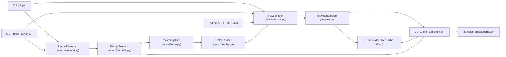

# 仓内模块依赖矩阵与影响面图谱

刻画 `src/octop_browser/` 各模块之间的真实 import / 调用边、高扇入底座枢纽与延迟导入边界，供 Agent 评估重构波及范围。所有边均附 `路径:行号` 的 import 或调用证据，不含推测边。

## 1. 模块依赖拓扑图

## 2. 模块×模块真实调用边明细

| 调用方模块（Caller） | 被调方模块（Callee） | 耦合介质 | 契约符号 | 证据锚点（`路径:行号`） |
|---|---|---|---|---|
| `cli.py` | `tool_interface.py` | 同步 import | `browser_tool` | `src/octop_browser/cli.py:40` |
| `mcp_server.py` | `tool_interface.py` | 同步 import | `browser_tool` | `src/octop_browser/mcp_server.py:18` |
| `__init__.py` | `tool_interface.py` | 包根导出 | `browser_tool` | `src/octop_browser/__init__.py:13` |
| `tool_interface.py` | `session.py` | 同步 import | `BrowserSession` | `src/octop_browser/tool_interface.py:12` |
| `session.py` | `actions/` | 同步 import | `capture`、`interact`、`js_eval`、`navigate` | `src/octop_browser/session.py:13`、`:14` |
| `session.py` | `cdp/client.py` | 同步 import | `CDPClient` | `src/octop_browser/session.py:15` |
| `session.py` | `cdp/launcher.py` | 同步 import | `get_page_ws_url`、`launch_or_attach` | `src/octop_browser/session.py:16` |
| `session.py` | `dom/` | 同步 import | `DOMBuilder`、`RefCache` | `src/octop_browser/session.py:17`、`:18` |
| `session.py` | `hooks.py`、`idle.py`、`models.py`、`profile.py` | 同步 import | `HooksMixin`、`BrowserIdleController`、`ToolResult`、`ProfileManager` | `src/octop_browser/session.py:19`–`:24` |
| `cdp/client.py` | `settings.py` | 同步 import | `settings` 单例 | `src/octop_browser/cdp/client.py:14` |
| `profile.py` | `settings.py` | 同步 import | `settings` 单例 | `src/octop_browser/profile.py:12` |
| `settings.py` | `mode.py` | 同步 import | `BrowserMode`、`normalize_mode` | `src/octop_browser/settings.py:63` |
| `cli.py` | `record/daemon.py` | 同步 import | `ensure_daemon`、`send_request` | `src/octop_browser/cli.py:35` |
| `cli.py` | `record/recorder.py`、`replay.py`、`store.py` | 同步 import | `RecordController`、`ReplayRunner`、`RecordingStore` | `src/octop_browser/cli.py:37`–`:39` |
| `mcp_server.py` | `record/daemon.py`、`recorder.py`、`replay.py`、`store.py` | 同步 import | 同上 | `src/octop_browser/mcp_server.py:14`–`:17` |
| `record/daemon.py` | `record/recorder.py` | 同步 import | `RecordController`、`RecordSession` | `src/octop_browser/record/daemon.py:14` |
| `record/recorder.py` | `cdp/launcher.py` | 同步 import | `get_page_ws_url`、`launch_or_attach` | `src/octop_browser/record/recorder.py:21` |
| `record/recorder.py` | `record/semantic.py`、`skill_generator.py`、`store.py`、`privacy.py` | 同步 import | `SemanticProcessor`、`SkillGenerator`、`RecordingStore`、`redact_event` | `src/octop_browser/record/recorder.py:29`–`:34` |
| `record/replay.py` | `tool_interface.py` | 同步 import | `browser_tool` | `src/octop_browser/record/replay.py:14` |
| `record/replay.py` | `record/matcher.py`、`store.py` | 同步 import | `match_target`、`RecordingStore` | `src/octop_browser/record/replay.py:11`–`:12` |
| `install.py` | `cdp/launcher.py`、`linux_deps.py`、`playwright_download.py` | 同步 import | `_find_playwright_chromium`、`build_install_steps`、`race_download_sources` | `src/octop_browser/install.py:57`–`:64` |
| `cdp/launcher.py` | `cdp/launch_prep.py` | **函数内延迟导入** | `prepare_chrome_launch`、`recover_profile` | `src/octop_browser/cdp/launcher.py:536` |
| `tool_interface.py` | `cdp/launcher.py` | **函数内延迟导入** | `terminate_browser` | `src/octop_browser/tool_interface.py:141` |
| `cdp/client.py` | `websockets`、`aiohttp` | 外部 SDK import | `websockets.connect` | `src/octop_browser/cdp/client.py:11` |

## 3. 变更爆炸半径与架构审计（Blast-Radius Audit）

- **高扇入核心底座（改签名必须全仓搜索调用点并跑全量单测）**：
  1. `tool_interface.browser_tool`（`src/octop_browser/tool_interface.py:91`）：被 `cli.py:40`、`mcp_server.py:18`、`__init__.py:13`、`record/replay.py:14` 四方直接依赖，另有回放链路逐步调用。
  2. `cdp.client.CDPClient.send`（`src/octop_browser/cdp/client.py:75`）：被 `session.py`、`actions/`、`record/recorder.py` 全部动作共用，出向帧字典改动影响每个动作。
  3. `settings.OctopSettings`（`src/octop_browser/settings.py:110`）：`cdp/client.py:14`、`profile.py:12`、`session.py:24`、`record/settings.py:9` 等均读其字段或 `state_dir()`。
  4. `profile.ProfileManager.get_or_create`（`src/octop_browser/profile.py:165`）：`session.py:228`、`record/recorder.py:333`、`tool_interface.py:145` 共用端口分配语义。
  5. `record/store.RecordingStore`（`src/octop_browser/record/store.py:14`）：录制、回放、CLI、MCP 四方共用同一磁盘目录树契约。
- **循环依赖与函数内延迟导入（Lazy Import）记录**：
  - `src/octop_browser/cdp/launcher.py:536` 在 `launch_or_attach` 内导入 `launch_prep`，避免 launcher ↔ launch_prep 的模块级环；`:485` 在 `terminate_browser` 内再次延迟导入。
  - `src/octop_browser/tool_interface.py:141` 在 `close_session` 分支内导入 `terminate_browser`，避免 tool_interface → launcher → profile → settings 的启动期环。
  - `src/octop_browser/idle.py:75` 在 `reap_now` 内导入 `terminate_browser` 与 `_drop_session`，打破 idle ↔ tool_interface 环。
  - `src/octop_browser/mcp_server.py:493` 在 `_main` 内延迟导入 `uvicorn`/`starlette`，stdio 模式无需这些可选依赖。
  - 除此之外未发现模块级循环 import。
- **内嵌子仓 / 跨进程边界约定**：无 `vendor/` 内嵌子仓；`record/daemon.py` 是独立 OS 进程（Unix socket + `start_new_session`），`cdp/launcher.py` 拉起 Chromium 子进程，二者均为静态调用图断链点，见 [主干调用链全景](../overview/callchain-panorama.md) 桥接表。

## 4. 跨仓依赖矩阵（`repo_deps` · 单仓模式）

本仓为 `single-repo` 工作区，`repoDeps = []`，无仓到仓依赖边，故无笛卡尔积占位边与跨仓环检测需求。外部下游依赖（Chrome CDP、Chromium 进程、Playwright CDN、Linux 包管理器、录制守护 IPC、MCP 传输运行时）均以 [上下游集成总览](../integrations/index.md) 下的独立契约页登记，不虚构 `repo_deps` 证据。

| 源仓 | 目标仓 | 依赖类型 | 具体契约接口 | 真实证据锚点 |
|---|---|---|---|---|
| — | — | — | 单仓模式，无跨仓边 | `operations/boundary.md` 第 4 节 |

## 5. 共变耦合与修改清单（Agent Co-Change Playbook）

- **改高扇入底座签名**：先用 `Grep` 枚举第 3 节列出的全部调用点，再跑 `pytest tests/unit/`，命令见 [构建与单测映射](../operations/dev-and-test.md)。
- **新增 import 边**：在本页 §2 补证据行，并检查是否引入模块级环；若必须在函数体内延迟导入，在 §3 记录原因。
- **改跨进程边界**：`record/daemon.py` 与 `cdp/launcher.py` 的桥接需同步 [主干调用链全景](../overview/callchain-panorama.md) 与 [部署与运行时](../operations/deployment-and-runtime.md)。
- **改 `repoDeps`**：单仓模式下恒为空数组；若未来纳管多仓，按真实 `repo/path:行号` 证据填写，禁止占位边。
