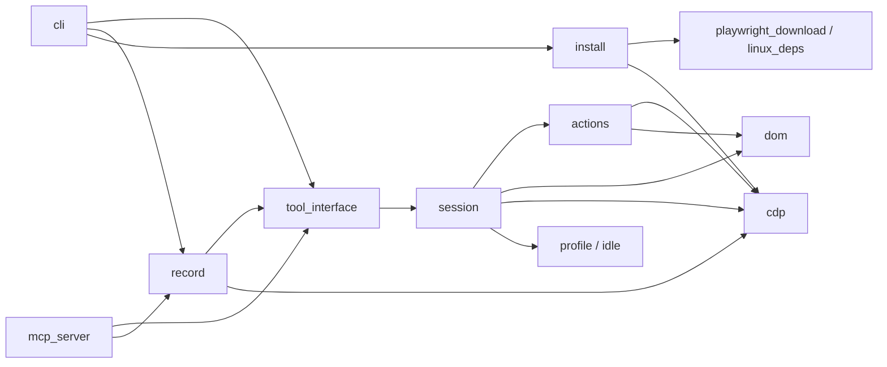

# 仓内模块依赖矩阵与影响面图谱

本仓为单仓工作区，依赖边全部来自真实 `from octop_browser...` 导入或函数内延迟导入。高扇入底座的签名变更会触发全仓连锁修改。

## 1. 模块依赖拓扑图

## 2. 模块×模块真实调用边明细

| 调用方模块 | 被调方模块 | 耦合介质 | 契约符号 | 证据锚点 |
|---|---|---|---|---|
| `cli` | `tool_interface` | 同步导入 | `browser_tool` | `src/octop_browser/cli.py:40` |
| `cli` | `record` | 同步导入 | `RecordController`、`ReplayRunner`、`send_request` | `src/octop_browser/cli.py:35-39` |
| `cli` | `install` | 同步导入 | `chromium_executable`、`ensure_chromium` | `src/octop_browser/cli.py:32` |
| `mcp_server` | `tool_interface` | 同步导入 | `browser_tool` | `src/octop_browser/mcp_server.py:18` |
| `mcp_server` | `record` | 同步导入 | `RecordController`、`ReplayRunner`、`RecordingStore`、`ensure_daemon` | `src/octop_browser/mcp_server.py:14-17` |
| `mcp_server` | `install` | 同步导入 | `install_chromium_stream` | `src/octop_browser/mcp_server.py:13` |
| `tool_interface` | `session` | 同步导入 | `BrowserSession` | `src/octop_browser/tool_interface.py:12` |
| `tool_interface` | `cdp.client` | 同步导入 | `CDPSessionError`（断链识别） | `src/octop_browser/tool_interface.py:8` |
| `tool_interface` | `cdp.launcher` | 函数内延迟导入 | `terminate_browser` | `src/octop_browser/tool_interface.py:141-142` |
| `session` | `actions` / `dom` / `cdp` | 同步导入 | `navigate`、`DOMBuilder`、`CDPClient` | `src/octop_browser/session.py:13-18` |
| `session` | `idle` | 同步导入 | `idle_controller_for`、`BrowserIdleController` | `src/octop_browser/session.py:20` |
| `session` | `cdp.launcher` | 函数内延迟导入 | `terminate_browser` | `src/octop_browser/session.py:156-157` |
| `idle` | `cdp.launcher` | 函数内延迟导入 | `terminate_browser` | `src/octop_browser/idle.py:75` |
| `idle` | `tool_interface` | 函数内延迟导入 | `_drop_session`（回收时同步清会话注册表） | `src/octop_browser/idle.py:76,79` |
| `actions` | `cdp.client` / `dom.refs` / `models` | 同步导入 | `CDPClient`、`RefCache`、`ToolResult` | `src/octop_browser/actions/interact.py:7-9` |
| `record.recorder` | `cdp.client` / `cdp.launcher` | 同步导入 | `CDPClient`、`launch_or_attach`、`get_page_ws_url` | `src/octop_browser/record/recorder.py:20-21` |
| `record.replay` | `tool_interface` | 同步导入 | `browser_tool`（回放逐步复用公开入口） | `src/octop_browser/record/replay.py:14` |
| `record.daemon` | `record.recorder` | 同步导入 | `RecordController`、`RecordSession` | `src/octop_browser/record/daemon.py:14` |
| `cdp.launcher` | `cdp.launch_prep` | 函数内延迟导入 | `prepare_chrome_launch`、`recover_profile`、`clear_profile_locks` | `src/octop_browser/cdp/launcher.py:536-539,485-488` |
| `cdp.launcher` | `settings` | 函数内延迟导入 | `settings`（避免 import 期读环境） | `src/octop_browser/cdp/launcher.py:161,191,365,435,506,637` |
| `install` | `cdp.launcher` | 同步导入 | `_find_playwright_chromium`（私有符号跨模块复用） | `src/octop_browser/install.py:57` |
| `install` | `playwright_download` / `linux_deps` | 同步导入 | `race_download_sources`、`build_install_steps` | `src/octop_browser/install.py:58-64` |

## 3. 变更爆炸半径与架构审计

- **高扇入核心底座（改签名必须全仓搜索调用点并跑全量单测）**：
  1. `settings`（被 `session`、`tool_interface`、`profile`、`cdp.client`、`cdp.launcher`、`idle`、`record.*`、`cli`、`mcp_server` 依赖）：核心契约 `OctopSettings`（`src/octop_browser/settings.py:109-180`）。
  2. `models`（被全部动作与入口依赖）：核心契约 `ToolResult` / `ActionMetrics`（`src/octop_browser/models.py:10-33`）。
  3. `cdp.client.CDPClient`（被 `session`、`actions/*`、`record/recorder.py` 依赖）：核心契约 `send(method, params)`（`src/octop_browser/cdp/client.py:75-116`）。
  4. `profile`（被 `session`、`tool_interface`、`cdp.launcher`、`cdp.launch_prep`、`idle`、`record/recorder.py` 依赖）：核心契约 `ProfileManager.get_or_create`（`src/octop_browser/profile.py:165-174`）。
  5. `tool_interface.browser_tool`（被 `cli`、`mcp_server`、`record/replay.py` 依赖）：核心契约 `action + profile + kwargs → ToolResult`（`src/octop_browser/tool_interface.py:91-212`）。

- **循环依赖与函数内延迟导入**：
  - `idle → tool_interface._drop_session`（`src/octop_browser/idle.py:76`）：回收 Chrome 时反向清会话注册表，避免模块顶层循环。
  - `tool_interface → cdp.launcher.terminate_browser`（`src/octop_browser/tool_interface.py:141`）：仅 `close_session(kill=True)` 分支触发。
  - `session → cdp.launcher.terminate_browser`（`src/octop_browser/session.py:156`）：仅 `close(kill=True)` 且无 idle controller 时触发。
  - `cdp.launcher → settings`（函数内多处）：`settings` 模块顶层导入 `mode`，但 `launcher` 在 `find_chrome` 等函数里再读全局，避免 import 期固化环境。
  - `record.replay → tool_interface`：回放反向依赖入向入口，形成 `tool_interface → session`/`record.replay → tool_interface` 的跨层回环，但无顶层循环导入。

- **进程边界约定**：`record.daemon` 以独立进程运行（`src/octop_browser/record/daemon.py:176-198`），与 `cli`/`mcp_server` 通过 Unix socket 解耦；静态依赖图在 `send_request()` 处断开，实际消息契约见 [`../operations/runbook-and-observability.md`](../operations/runbook-and-observability.md)。

## 4. 跨仓依赖矩阵

单仓模式，`repo_deps` 为空。README 列出的 harness-agent / harness-memory / harness-gateway / Octop 为上层组合方，本仓源码内**未找到**对应导入或 RPC 客户端，不构造跨仓边。外部系统仅 Chrome CDP 与 Playwright CDN/包管理器，详见 [`../integrations/index.md`](../integrations/index.md)。

## 5. 共变耦合与修改清单

- 改 `OctopSettings` 字段：全仓 `grep "cfg\."` 与 `_env_*` 读取点都要核对，同步 `../contracts/configuration.md`，跑 `tests/unit/test_settings.py`。
- 改 `ToolResult` 结构：影响所有 `actions/*`、CLI JSON 与 hook 载荷，跑 `pytest tests/unit/ -q`。
- 改延迟导入位置：确认仍在函数体内，防止顶层 import 期循环；跑 `tests/unit/test_tool_interface.py`、`tests/unit/test_idle.py`。
- 改 `record.replay → tool_interface` 依赖方向：需重新评估回放的可测试性，跑 `tests/unit/test_record_replay_replay_runner.py`。
