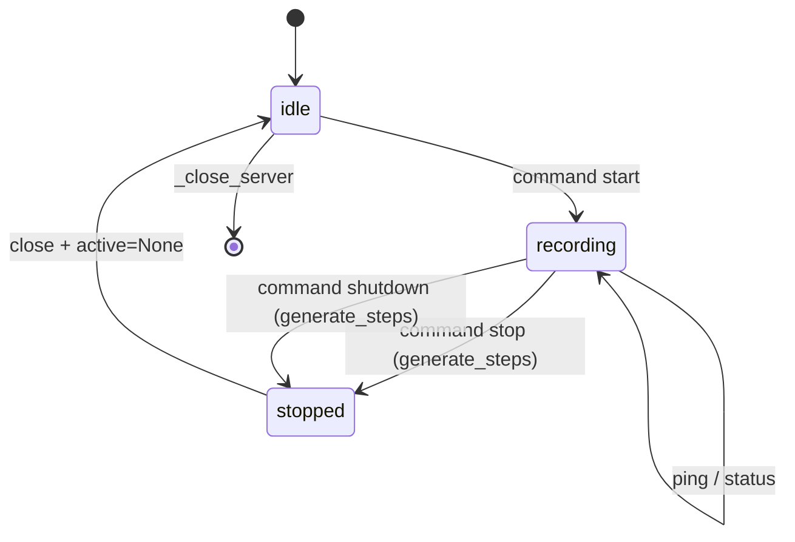

# 录制守护进程与注入式采集组件（定时 / 异步 Worker）

`record/daemon.py` 以独立 OS 进程跑 `asyncio.start_unix_server`，持有唯一 `RecordSession` 跨越短命 CLI/MCP 调用；`RecordSession` 经 `Page.addScriptToEvaluateOnNewDocument` 注入 `recorder.js`，由 `Runtime.bindingCalled` 回传事件，经脱敏后 `flush` 到 `events.jsonl`。并发模型是「单活跃录制 + 0.5s 目标轮询 + 独立子进程」，不含 MQ，也不持久化任务恢复。

## 1. 后台任务类型全集（Job Registry）

| 任务标识 | 触发源 | 间隔 / 超时阈值 | 执行主函数（`路径:行号`） | 最终状态与产物落点 |
|---|---|---|---|---|
| `daemon-serve` | `python -m octop_browser.record.daemon` | `serve_forever()`，无超时 | `RecordDaemon.run` (`src/octop_browser/record/daemon.py:107`) | `daemon.sock` 与 `daemon.pid`，退出时双双 `unlink` |
| `daemon-ensure` | CLI/MCP `record start` | 30 次 × `0.1s` 探活 | `ensure_daemon` (`src/octop_browser/record/daemon.py:190`) | 拉起子进程并返回 `{"ok": True, "pid": ...}` |
| `recording-session` | `command == "start"` 请求 | 单实例互斥 | `RecordController.start_in_process` (`src/octop_browser/record/recorder.py:350`) | `manifest.json`、`events.jsonl`、停录时 `steps.json` 与 `draft.skill.md` |
| `target-poll` | `RecordSession.start` | `asyncio.sleep(0.5)` | `_poll_targets` (`src/octop_browser/record/recorder.py:220`) | 新标签自动 `_install_on_client`，关闭标签回收 `CDPClient` |
| `input-debounce` | 页面 `input` 事件 | `setTimeout(..., 300)` | `onInput` (`src/octop_browser/record/injected/recorder.js:264`) | 合并 300ms 内输入后 `emit("input")` |
| `scroll-throttle` | 页面 `scroll` 事件 | `500ms` | `onScroll` (`src/octop_browser/record/injected/recorder.js:289`) | 超限直接丢弃 |
| `rate-limit` | 每个 binding 回调 | 每秒 100 条、单事件 65536 字节 | `_rate_limit_ok` (`src/octop_browser/record/recorder.py:232`)、`_on_binding_called` (`:264`) | 超限静默丢弃，不写盘 |

## 2. 执行流与并发控制调用树

```text
daemon-start (cli.py:542) -> ensure_daemon() (src/octop_browser/record/daemon.py:190)
  ├─ is_running() -> send_request({"command":"ping"}, timeout=1.0) (src/octop_browser/record/daemon.py:168)
  ├─ [未运行] start_daemon_process() (src/octop_browser/record/daemon.py:176)
  │    └─ subprocess.Popen([sys.executable,"-m","octop_browser.record.daemon"], start_new_session=True) (src/octop_browser/record/daemon.py:186)
  └─ [就绪] dispatch({"command":"start", ...}) (src/octop_browser/record/daemon.py:43)
       ├─ [guard] self.active is not None -> {"ok": False, "error": "A recording is already active"} (:44)
       ├─ PrivacySettings(input_policy=privacy, url_query_policy="mask-sensitive", screenshot_policy=screenshots) (:50)
       ├─ RecordController.start_in_process -> RecordSession.start (:83)
       │    ├─ Runtime.addBinding(name=__hbr_emit_<hex>) (src/octop_browser/record/recorder.py:170)
       │    ├─ Page.addScriptToEvaluateOnNewDocument(source=config+recorder.js) (:172)
       │    ├─ _attach_known_targets() 为每个既有 page 建 CDPClient (:193)
       │    └─ asyncio.create_task(_poll_targets()) (:99)
       └─ data["daemon"] = True (:62)

binding 回调 (_on_binding_called, src/octop_browser/record/recorder.py:256)
  ├─ [guard] params["name"] != binding_name 或 not active -> return (:257)
  ├─ [guard] payload["nonce"] != self.nonce -> return (:273)
  ├─ [guard] 字节 > max_event_bytes 或 _rate_limit_ok() 为假 -> return (:264)
  ├─ 补 targetId / page.targetId (:278)
  └─ _append(event) (:286) -> redact_event() (src/octop_browser/record/privacy.py:61)
       └─ store.append_event + stats.events += 1 + write_manifest (src/octop_browser/record/recorder.py:249)
```

## 3. 任务状态机与阶段契约



| 状态存储与轮询机制 | 实现细节 | 源码锚点 |
|---|---|---|
| 单活跃互斥 | `self.active` 非空即拒绝第二个 `start`，返回当前 `_active_info()` | `src/octop_browser/record/daemon.py:44` |
| 活跃摘要 | `{"recordingId", "profile", "startUrl", "events"}` | `src/octop_browser/record/daemon.py:93` |
| 停录副作用 | `status="stopped"`、`ended_at`、写回 manifest；可选 `generate_steps` 触发语义折叠与 skill 草稿 | `src/octop_browser/record/recorder.py:110` |
| 关闭清理 | `shutdown` 先停录再 `call_soon(_close_server)`，socket 与 pid 文件在 `finally` 删除 | `src/octop_browser/record/daemon.py:84`、`src/octop_browser/record/daemon.py:121` |
| 进程重启影响 | 全部状态在内存，重启即丢失活跃录制；已落盘 `events.jsonl` 与 manifest 保留 | `src/octop_browser/record/daemon.py:20` |
| 不可达降级 | `send_request` 捕获 `OSError/TimeoutError` 返回 `{"ok": False, "error": "Record daemon is not running..."}` | `src/octop_browser/record/daemon.py:152` |

## 4. 注入事件载荷与脱敏规则

`recorder.js` 的 `emit` 统一构造 `{nonce, schemaVersion: "1.0", event: {localSeq, kind, ts, targetId, page, ...data}}`（`src/octop_browser/record/injected/recorder.js:60`）；`describeElement` 产出 `tag/role/name/accessibleName/text/label/placeholder/id/nameAttr/type/testId/selectorCandidates/xpath/bbox/visible/enabled/isContentEditable/framePath/shadowPath`（`:201`）。`kind` 全集为 `recorder_installed/page_opened/click/dblclick/input/change/keydown/submit/scroll/navigation/history.pushState/history.replaceState/popstate/hashchange`（:55 起的各 emit 点）。Python 侧 `redact_event` 对 `page.url`、`url`、`urlBefore`、`urlAfter` 做 query Key 脱敏（`src/octop_browser/record/privacy.py:71`），`mask-all` 或 `mask-sensitive` 命中敏感字段时把 `value` 改为 `{{sensitive_value}}` 并置 `redacted=True`（`:74`）。

## 5. 共变耦合与修改清单（Agent Co-Change Playbook）

- **新增 daemon 命令**：`dispatch` 分支（`src/octop_browser/record/daemon.py:39`）、`_TOOLS` 中 `browser_record_*`（`src/octop_browser/mcp_server.py:156`）、CLI `record` 子解析器（`src/octop_browser/cli.py:320`）与 [录制守护 IPC](../integrations/downstream/record-daemon-ipc.md) 的请求字典四处同步。
- **修改事件 `kind` 集合**：`recorder.js` 的 emit 点、`SemanticProcessor._filter_events` 白名单（`src/octop_browser/record/semantic.py:353`）、`_build_steps` 分支（`:396`）与 [录制采集流程](../business/wf-record-capture.md) 联动。
- **单测隔离铁律**：守护进程测试只测客户端协议（`tests/unit/test_record_daemon_client.py`），禁止在单测中真起 `start_new_session` 子进程；端到端用 `scripts/record_replay_smoke.py:57`。
- **必跑回归**：`pytest tests/unit/test_record_daemon_client.py tests/unit/test_record_replay_store_skill.py tests/unit/test_record_replay_semantic.py`。
