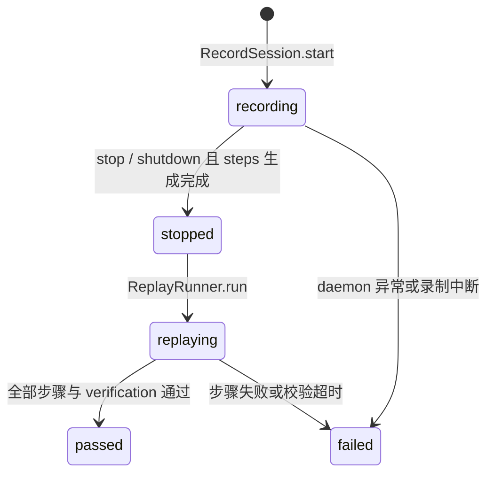

# 录制与回放异步 Worker 组件

本组件把真实浏览过程固化为可重放意图：常驻 Unix-socket daemon 持有 `RecordSession`，注入 JS 通过 CDP binding 上报事件，语义处理器折叠成 `steps.json`，回放器按步骤重新驱动浏览器动作。它不是坐标回放，而是「意图回放 + 实时 DOM 目标重匹配」，见 [`../business/wf-record-replay.md`](../business/wf-record-replay.md)。

## 1. 硬边界与不变量

1. **单一活动录制**：daemon 在 `active is not None` 时拒绝新的 `start`（`src/octop_browser/record/daemon.py:43-63`）。
2. **事件真实性**：JS 注入事件必须携带录制时随机生成的 `nonce`，否则丢弃（`src/octop_browser/record/recorder.py:273-274`）。
3. **先脱敏后落盘**：所有事件在 `RecordSession._append()` 内先过 `redact_event()` 再 `append_event()`（`src/octop_browser/record/recorder.py:240-254`）。
4. **replay 目标重匹配**：步骤里的 `target` 只是描述，执行时必须用 `match_target()` 对当次 `structured` DOM 重新打分（阈值 45 分，`src/octop_browser/record/matcher.py:60-62`）。
5. **失败即停**：任一步失败立即写 `failureArtifacts` 并终止后续步骤（`src/octop_browser/record/replay.py:272-280`）。

## 2. 后台任务类型全集

| 任务标识 | 触发源 | 并发/周期 | 执行主函数 | 产物落点 |
|---|---|---|---|---|
| `record start`（daemon 模式） | CLI / MCP `record start` | Unix socket 单连接顺序处理 | `RecordDaemon.dispatch()` (`src/octop_browser/record/daemon.py:39-91`) | `recordings/<id>/events.jsonl` |
| `record start --duration` | CLI 带时长参数 | 进程内协程 `asyncio.sleep` | `RecordController.start_in_process()` (`src/octop_browser/record/recorder.py:350-395`) | 同上 + 自动 generate-steps |
| `record stop` | CLI / MCP | 消息驱动 | `RecordSession.stop()` (`src/octop_browser/record/recorder.py:101-134`) | `steps.json`、`draft.skill.md` |
| `replay run` | CLI / MCP | 顺序步骤循环 | `ReplayRunner.run()` (`src/octop_browser/record/replay.py:25-298`) | `replay-reports/replay_*.json` |
| 目标页轮询 | `RecordSession.start()` 自动拉起 | 每 0.5 秒 | `_poll_targets()` (`src/octop_browser/record/recorder.py:220-230`) | 动态增删 CDP 客户端 |

## 3. 执行流与并发控制调用树

```text
RecordController.start_in_process() -> src/octop_browser/record/recorder.py:350-395
  ├─ _attach(profile) -> launch_or_attach + get_page_ws_url : :331-339
  ├─ 构造 RecordingManifest(rec_id, start_url, privacy) : :367-377
  ├─ RecordingStore.create() 建目录 + 空 events.jsonl : :378, store.py:45-62
  └─ RecordSession.start() -> :83-99
       ├─ _install_on_client(): Runtime.addBinding + Page.addScriptToEvaluateOnNewDocument
       │    + Runtime.evaluate 注入 recorder.js : :165-180
       ├─ _attach_known_targets() 为每个 page target 建独立 CDPClient : :193-218
       └─ asyncio.create_task(_poll_targets()) 追踪新标签/死标签 : :220-230

事件上行：JS emit() -> bindingCalled -> _on_binding_called() -> _append()
  ├─ [guard] 字节数 > max_event_bytes 或 每秒 > max_events_per_second -> 丢弃 : recorder.py:232-238,263-268
  ├─ [guard] nonce 不符 -> 丢弃 : :273-274
  └─ redact_event -> append_event -> stats.events++ -> write_manifest : :240-254

RecordSession.stop(generate_steps=True) -> :101-134
  ├─ 取消轮询任务，manifest.status="stopped"，ended_at 写回 : :104-112
  └─ SemanticProcessor.process() -> write_steps -> SkillGenerator.generate() (`src/octop_browser/record/skill_generator.py:32-99`) -> write_skill : :117-133
```

语义折叠主链 `SemanticProcessor.process()`：`_filter_events()` 保留 15 种 kind → `_start_url()` 识别起始页 → `_build_steps()` 逐事件生成 `open/click/fill/select/set_checked/press/navigate/new_tab/scroll_to`（`src/octop_browser/record/semantic.py:338-593`）→ `_infer_variables()` 把输入值替换为 `{{name}}`（`src/octop_browser/record/semantic.py:614-624`）→ `_attach_navigation_expectations()` 把后续导航挂到前序动作的 `expect.urlAfter`（`src/octop_browser/record/semantic.py:626-648`）。

## 4. 状态机与落盘目录契约



| 存储载体 | 精确路径模板 | 权威写入方 | 读取方 | 并发机制 |
|---|---|---|---|---|
| 录制清单 | `recordings/<id>/manifest.json` | `RecordingStore.write_manifest` (`src/octop_browser/record/store.py:64-76`) | `read_manifest` / `recording_summary` (`:78-80,135-162`) | 写 `.json.tmp` 后原子 `replace` |
| 原始事件 | `recordings/<id>/events.jsonl` | `append_event` (`src/octop_browser/record/store.py:82-87`) | `read_events` (`:88-97`) | append + `flush()`，权限 0600 |
| 语义步骤 | `recordings/<id>/steps.json` | `write_steps` (`src/octop_browser/record/store.py:99-109`) | `read_steps` (`:111-114`) | 全量覆盖写 |
| Skill 草稿 | `recordings/<id>/draft.skill.md` | `write_skill` (`src/octop_browser/record/store.py:116-119`) | Agent 直接读取 | 全量覆盖写 |
| 回放报告 | `recordings/<id>/replay-reports/replay_<ts>.json` | `_write_report` (`src/octop_browser/record/replay.py:647-657`) | `recording_summary` 取最新 | 时间戳命名不覆盖 |
| daemon 通道 | `daemon.sock` / `daemon.pid` | `socket_path` / `pid_path` (`src/octop_browser/record/daemon.py:132-137`) | `send_request` (`:140-165`) | 启动时先 unlink 旧 socket |

## 5. 脱敏与 URL 过滤规则

- `redact_url()` 对 query key 命中 `URL_KEYS`（token/code/session/key/secret/password/auth/jwt 等 11 项）的值替换为 `***`（`src/octop_browser/record/privacy.py:12-40`）。
- `redact_event()` 按 `input_policy` 决定 `{{sensitive_value}}`；`mask-sensitive` 还依赖 `is_sensitive_target()` 对 type/name/placeholder/label/id 做正则匹配（`src/octop_browser/record/privacy.py:43-81`）。
- `is_replayable_page_url()` 排除 `about:blank`、`chrome://`、`devtools://` 与四类已知风控跳转（微博 visitor/newlogin、百度 captcha、小红书 login/error），但**不**过滤一般登录页，以保留显式登录流程（`src/octop_browser/record/url_filter.py:7-53`）。
- 回放阶段对 `navigate` 步骤再次调用 `is_transient_auth_or_risk_url()`，命中则标记 `skipped` 并给出 `reason`（`src/octop_browser/record/replay.py:208-219`）。

## 6. 共变耦合与修改清单

- **新增 JS 事件 kind**：`recorder.js` 的 `emit()` → `SemanticProcessor._filter_events()` 白名单 → `_build_steps()` 分支 → `ReplayRunner.run()` 分发 → `tests/unit/test_record_replay_semantic.py`。
- **改目标描述字段**：注入端 `describeElement()`（`src/octop_browser/record/injected/recorder.js:201-232`）→ 精简 `_compact_target()`（`src/octop_browser/record/semantic.py:44-79`）→ 打分 `match_target()`（`src/octop_browser/record/matcher.py:19-62`）三处必须同步。
- **改 daemon 命令键**：CLI（`src/octop_browser/cli.py:537-607`）与 MCP（`src/octop_browser/mcp_server.py:395-457`）两边构造的请求字典都要改，跑 `tests/unit/test_record_daemon_client.py`。
- **改脱敏策略**：同步 `contracts/configuration.md` 策略说明与 `tests/unit/test_record_replay_store_skill.py`，禁止把原始值写入日志。

## 7. 关联文档

- [WF-02 录制回放流程](../business/wf-record-replay.md) · [核心数据模型](../business/domain-models/index.md) · [Chrome CDP 出向契约](../integrations/downstream/chrome-cdp.md)
