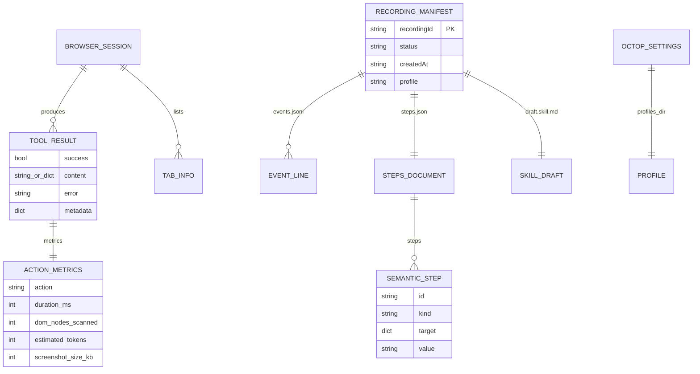

# 核心领域与数据模型总览

本仓无关系型数据库，领域状态分两类：**进程内存中的值对象**（`ToolResult`、`ActionMetrics`、`TabInfo`、`OctopSettings`）与**磁盘上的录制产物**（`RecordingManifest`、`StepsDocument` 及配套 JSON/JSONL/Markdown）。本页给出总览与读写归属矩阵，精确字段字典拆见 [工具结果与指标模型](tool-result-and-metrics.md) 与 [录制产物模型](recording-artifacts.md)。

## 1. 实体与存储关系图

## 2. 精确字段字典（顶层实体）

| 实体 | 业务语义 | 持久化权威位置 | 权威定义（`路径:行号`） | 专页 |
|---|---|---|---|---|
| `ToolResult` | 每个动作与 `browser_tool` 的统一返回 | 仅内存，不落库 | `src/octop_browser/models.py:20` | [工具结果与指标模型](tool-result-and-metrics.md) |
| `ActionMetrics` | 单次动作的耗时 / token / 截图体积 | 内嵌于 `ToolResult` | `src/octop_browser/models.py:10` | 同上 |
| `TabInfo` | 单个页目标摘要 | `list_tabs` 的 `metadata.tabs` | `src/octop_browser/models.py:36` | 同上 |
| `OctopSettings` | 14 个环境驱动运行参数 | 进程单例，非磁盘 | `src/octop_browser/settings.py:110` | [配置手册](../../contracts/configuration.md) |
| `Profile` | `name/data_dir/cdp_port` 三元组 | `.octop-browser-profiles.json` 与目标状态文件 | `src/octop_browser/profile.py:33` | [CDP 传输与存储](../../architecture/cdp-transport-and-storage.md) |
| `RecordingManifest` | 录制元数据与统计 | `<id>/manifest.json` | `src/octop_browser/record/models.py:32` | [录制产物模型](recording-artifacts.md) |
| `SemanticStep` | 一条可回放意图 | `<id>/steps.json` 的 `steps[]` | `src/octop_browser/record/models.py:69` | 同上 |
| `StepsDocument` | 回放输入、步骤与验证条件 | `<id>/steps.json` | `src/octop_browser/record/models.py:80` | 同上 |
| `InstallEvent` | 安装流水线一条日志或终态 | 仅内存流 | `src/octop_browser/install.py:81` | [Playwright 安装器](../../integrations/downstream/playwright-installer.md) |
| `TargetDescriptor` | 录制元素的完整描述（18 键） | `events.jsonl` 的 `target` | `src/octop_browser/record/models.py:46` | [录制采集流程](../wf-record-capture.md) |

## 3. 全库存储介质与读写归属矩阵

| 存储载体 | 精确路径模板 | 权威写入方 | 读取消费方 | 并发与原子性机制 |
|---|---|---|---|---|
| 进程内存 | `ToolResult` / `_registry` / `_TASKS` 类字典 | `browser_tool` (`src/octop_browser/tool_interface.py:91`) | CLI/MCP 响应序列化 | 事件循环单线程，无锁 |
| SQLite | **不存在**（全仓无 SQL / DDL，`.wally/docs/sqls/README.md` 为 SOP 空模板） | 无 | 无 | 不适用 |
| 磁盘 JSON | `<profiles_dir>/.octop-browser-profiles.json` | `ProfileManager._save_ports` (`src/octop_browser/profile.py:143`) | `_load_ports` (`:123`) | 整文件覆盖写，读时过滤非法值 |
| 磁盘 JSON | `<profile_dir>/.octop-browser-target.json` | `Profile.save_target` (`:69`) | `load_target` (`:49`) | best-effort，失败仅 debug |
| 磁盘 JSON | `<id>/manifest.json` | `RecordingStore.write_manifest` (`src/octop_browser/record/store.py:64`) | `read_manifest` (`:78`)、`recording_summary` (`:135`) | `.json.tmp` + `replace()` 原子替换 |
| 磁盘 JSONL | `<id>/events.jsonl` | `append_event` (`:82`) | `read_events` (`:88`)、`SemanticProcessor` | 追加写 + `flush()`，按 `seq` 排序 |
| 磁盘 JSON | `<id>/steps.json` | `write_steps` (`:99`) | `read_steps` (`:111`)、`ReplayRunner` | 全量覆盖写 |
| 磁盘 Markdown | `<id>/draft.skill.md` / `final.skill.md` | `write_skill` (`:116`) | 人工 / Agent 复用 | 全量覆盖写 |
| 磁盘 JSON | `<id>/replay-reports/replay_<时间>.json` | `ReplayRunner._write_report` (`src/octop_browser/record/replay.py:647`) | `recording_summary` (`:141`) | 按时间戳新建 |
| 磁盘 PNG | `<screenshots_dir>/octop-<ms>.png` 或显式 `path` | `actions.capture.screenshot` (`src/octop_browser/actions/capture.py:186`) | 调用方按 `content` 路径读取 | `write_bytes` 覆盖 |

## 4. 字段增删改共变清单（Schema Change Playbook）

新增或重命名任一字段时必须同步：Pydantic/dataclass 定义（`src/octop_browser/models.py:10` 或 `src/octop_browser/record/models.py:32`）→ 序列化与别名（`model_dump(mode="json", by_alias=True)`，`src/octop_browser/record/store.py:70`）→ 读写函数（`src/octop_browser/record/store.py:99`、`:111`）→ 对外 DTO 与 `ToolResult.metadata`（`src/octop_browser/session.py:846`）→ 单测 Fixture（`tests/unit/test_models.py`、`tests/unit/test_record_replay_store_skill.py`）→ 本索引与 [术语表](../../overview/glossary.md)。字段别名（如 `schemaVersion`/`recordingId`/`startUrl`）由 `Field(alias=...)` 与 `model_config = {"populate_by_name": True}` 共同决定（`src/octop_browser/record/models.py:43`），改名必须同时核对磁盘 JSON 的旧别名兼容。
