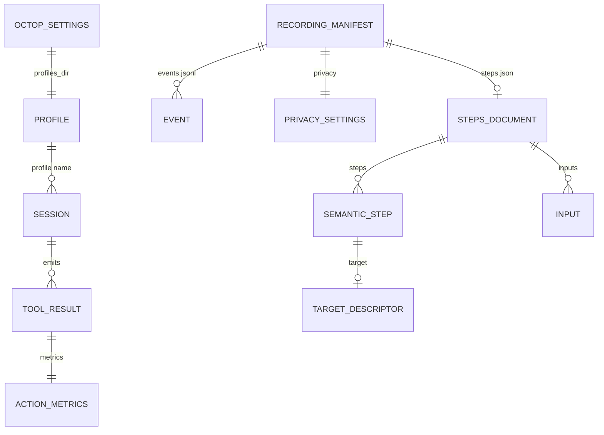

# 核心领域与数据模型总览

本仓没有数据库表：权威状态分两类，一类是内存中的 Pydantic/Dataclass 模型（`ToolResult` 系列、录制/步骤模型、配置对象），一类是磁盘上的 JSON/JSONL 文件与 Chrome user-data-dir。Writer/Reader 边界必须严格区分，避免改错持久化归属。

## 1. 实体与存储关系图

## 2. 精确字段字典

### 2.1 运行时内存模型

| 字段 / 键路径 | 类型 | 必填 / 默认值 | 枚举值与约束 | 定义锚点 |
|---|---|---|---|---|
| `ToolResult.success` | `bool` | 必填 | `False` 时必须检查 `error` | `src/octop_browser/models.py:29` |
| `ToolResult.content` | `str \| dict[str, object]` | 必填 | 截图为路径字符串；structured DOM 为 JSON 字符串 | `src/octop_browser/models.py:30` |
| `ToolResult.error` | `str \| None` | `None` | 成功时无错误 | `src/octop_browser/models.py:31` |
| `ToolResult.metrics` | `ActionMetrics` | 必填 | 不允许缺省 | `src/octop_browser/models.py:32` |
| `ToolResult.metadata` | `dict[str, object] \| None` | `None` | 截图写入 `path/url/title/width/height/size_kb` | `src/octop_browser/models.py:33`、`src/octop_browser/actions/capture.py:206-215` |
| `ActionMetrics.duration_ms` | `int` | 必填 | 由 `time.monotonic()` 差值 ×1000 | `src/octop_browser/models.py:14` |
| `ActionMetrics.estimated_tokens` | `int` | 必填 | `len(content) // 4` | `src/octop_browser/models.py:16` |
| `ActionMetrics.screenshot_size_kb` | `int` | `0` | `len(img_bytes) // 1024` | `src/octop_browser/models.py:17` |
| `TabInfo.tab_id` | `str` | 必填 | 来自 CDP target 的 `id` | `src/octop_browser/models.py:39` |
| `TabInfo.active` | `bool` | 必填 | 与 profile 黏性 target id 比对得出 | `src/octop_browser/models.py:42`、`src/octop_browser/session.py:810-829` |

### 2.2 录制与步骤模型

| 字段 / JSON 键路径（别名） | 类型 | 必填 / 默认值 | 枚举值与约束 | 定义锚点 |
|---|---|---|---|---|
| `RecordingManifest.schemaVersion` | `str` | `"1.0"` | 别名 `schema_version` | `src/octop_browser/record/models.py:33` |
| `RecordingManifest.recordingId` | `str` | 必填 | 别名 `recording_id` | `src/octop_browser/record/models.py:34` |
| `RecordingManifest.status` | `RecordingStatus` | `"recording"` | `recording \| stopped \| failed` | `src/octop_browser/record/models.py:35,9` |
| `RecordingManifest.profile` | `str` | `"default"` | profile 名 | `src/octop_browser/record/models.py:38` |
| `RecordingTarget.start_url` / `end_url` / `title` | `str` / `str \| None` | `""` / `None` / `""` | 值来自 CDP `Runtime.evaluate` 与事件 page.url | `src/octop_browser/record/models.py:20-25` |
| `PrivacySettings.input_policy` | `InputPolicy` | `"mask-sensitive"` | `none \| mask-sensitive \| mask-all` | `src/octop_browser/record/models.py:15,10` |
| `PrivacySettings.screenshot_policy` | `ScreenshotPolicy` | `"off"` | 四态，CLI 固定传 `off` | `src/octop_browser/record/models.py:17,11` |
| `RecordingStats.events` / `steps` | `int` | `0` | 每条事件/步骤落盘时更新 | `src/octop_browser/record/models.py:27-29` |
| `TargetDescriptor.selectorCandidates` | `list[str]` | `[]` | 注入 JS 最多取 8 条 | `src/octop_browser/record/models.py:58-60`、`src/octop_browser/record/injected/recorder.js:156-174` |
| `SemanticStep.kind` | `str` | 必填 | `open/click/fill/select/set_checked/press/navigate/new_tab/scroll_to` | `src/octop_browser/record/models.py:69-77` |
| `SemanticStep.expect` | `dict[str, Any] \| None` | `None` | 导航期望写入 `urlAfter` 与 `urlContains` | `src/octop_browser/record/models.py:77`、`src/octop_browser/record/semantic.py:626-643` |
| `StepsDocument.inputs` | `list[dict[str, Any]]` | `[]` | 每项含 `name/kind/required`，可选 `example` | `src/octop_browser/record/models.py:84`、`src/octop_browser/record/semantic.py:167-170` |
| `StepsDocument.verification` | `list[dict[str, Any]]` | `[]` | 当前只推断 `url_contains` 一种 | `src/octop_browser/record/models.py:86`、`src/octop_browser/record/semantic.py:665-669` |

### 2.3 配置与身份模型

| 字段 | 类型 | 默认值 | 约束 | 定义锚点 |
|---|---|---|---|---|
| `OctopSettings.profiles_dir` | `Path` | `state_dir()/profiles` | 由 `BROWSER_USE_PROFILES_DIR` 覆盖 | `src/octop_browser/settings.py:128-132` |
| `OctopSettings.cdp_host` | `str` | `"localhost"` | 非 loopback 时禁止本地启动 | `src/octop_browser/settings.py:139-143` |
| `OctopSettings.cdp_max_message_size` | `int \| None` | `33554432` | 环境变量为 0 时转 `None`（不设上限） | `src/octop_browser/settings.py:171-177` |
| `OctopSettings.browser_mode` | `BrowserMode` | `"auto"` | 经 `normalize_mode()` 校验 | `src/octop_browser/settings.py:178-180` |
| `RecordReplaySettings.base_dir` | `Path` | `state_dir()/record-replay` | `BROWSER_RECORD_REPLAY_DIR` 覆盖 | `src/octop_browser/record/settings.py:23-29` |
| `RecordReplaySettings.max_event_bytes` | `int` | `65536` | 单条 JS 事件 payload 上限 | `src/octop_browser/record/settings.py:30-32` |
| `RecordReplaySettings.max_events_per_second` | `int` | `100` | 每秒事件数上限 | `src/octop_browser/record/settings.py:33-35` |
| `Profile.name` / `data_dir` / `cdp_port` | `str` / `Path` / `int` | 由管理器分配 | `cdp_port = cdp_port_start + 最小空闲序号` | `src/octop_browser/profile.py:33-39,151-174` |
| `InstallEvent` | `TypedDict(total=False)` | `log / done / success / error` 四键 | `log` 与终态键互斥 | `src/octop_browser/install.py:81-91` |

## 3. 存储介质与读写归属矩阵

| 存储载体 | 精确路径模板 | 权威写入方 | 读取消费方 | 并发与原子性 |
|---|---|---|---|---|
| Profile 端口账本（JSON） | `profiles_dir/.octop-browser-profiles.json` | `ProfileManager._save_ports` (`src/octop_browser/profile.py:143-149`) | `_load_ports` (`:123-141`) | 全量覆盖写，进程内字典无锁 |
| 页面目标黏性（JSON） | `profiles_dir/<name>/.octop-browser-target.json` | `Profile.save_target` (`src/octop_browser/profile.py:69-84`) | `load_target` (`:49-67`)、`get_page_ws_url` (`src/octop_browser/cdp/launcher.py:652-660`) | 写失败静默降级 |
| Chrome 用户数据 | `profiles_dir/<name>/` (user-data-dir) | Chrome 进程自身（由 `launch_or_attach` 传入） | 下次 attach 复用登录态 | 由 Chrome 管理；启动前清 SingletonLock |
| 截图 PNG | `screenshots_dir/octop-<timestamp_ms>.png` 或显式 `path` | `capture.screenshot` (`src/octop_browser/actions/capture.py:185-187`) | 调用方按返回路径读取 | 显式 path 为覆盖写 |
| 录制清单（JSON） | `recordings/<id>/manifest.json` | `RecordingStore.write_manifest` (`src/octop_browser/record/store.py:64-76`) | `read_manifest`、`recording_summary` | `.json.tmp` + `replace` 原子写 |
| 原始事件（JSONL） | `recordings/<id>/events.jsonl` | `append_event` (`src/octop_browser/record/store.py:82-87`) | `read_events`、`SemanticProcessor` | append + flush，权限 0600 |
| 语义步骤（JSON） | `recordings/<id>/steps.json` | `write_steps` (`src/octop_browser/record/store.py:99-109`) | `ReplayRunner` (`src/octop_browser/record/replay.py:31`) | 全量覆盖写 |
| Skill 草稿（Markdown） | `recordings/<id>/draft.skill.md` | `write_skill` (`src/octop_browser/record/store.py:116-119`) | Agent 直接读取 | 全量覆盖写 |
| 回放报告（JSON） | `recordings/<id>/replay-reports/replay_<ts>.json` | `_write_report` (`src/octop_browser/record/replay.py:647-657`) | `recording_summary` 取最新 | 时间戳命名，不覆盖 |
| daemon 通道 | `record-replay/daemon.sock` / `daemon.pid` | `RecordDaemon.run` (`src/octop_browser/record/daemon.py:107-129`) | `send_request` (`:140-165`) | 启动时 unlink 旧 socket |

## 4. 字段增删改共变清单

1. 改 `ToolResult` 字段：同步 `src/octop_browser/cli.py:502-511` 的 JSON 渲染与 `../contracts/api-reference.md`，跑 `tests/unit/test_models.py`、`tests/unit/test_cli.py`。
2. 改录制模型别名：所有落盘用 `model_dump(by_alias=True)`（`src/octop_browser/record/store.py:68-75,99-108`），别名变更会让旧录制无法解析，必须保留 `populate_by_name` 兼容。
3. 改配置默认值：同时更新 `../contracts/configuration.md` 与 `tests/unit/conftest.py` 的环境隔离前缀；新增 `BROWSER_USE_*` 变量会被单测自动清理。
4. 改磁盘目录布局：同步 `../operations/deployment-and-runtime.md` 的目录树契约与 `state_dir()` 的旧目录回退逻辑。

## 5. 关联文档

- [业务流程总表](../index.md) · [配置全集](../../contracts/configuration.md) · [术语与符号映射](../../overview/glossary.md)
