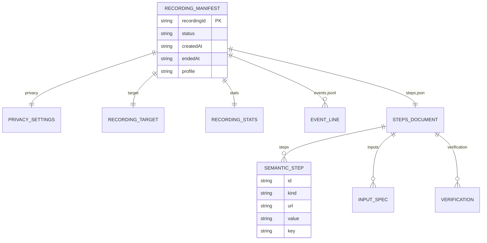

# 录制产物与语义步骤数据模型

一次录制在 `<record-replay>/recordings/<id>/` 下生成一棵固定目录树：`manifest.json`、`events.jsonl`、可选 `steps.json` 与 `draft.skill.md`，以及 `screenshots/`、`snapshots/`、`replay-reports/` 三个子目录。所有结构化模型定义在 `record/models.py`，由 `RecordingStore` 统一读写；别名采用 camelCase 落盘（`recordingId`、`startUrl`、`schemaVersion`），Python 侧用 snake_case。

## 1. 实体与存储关系图

## 2. 精确字段字典（Exact Schema Dictionary）

### 2.1 `RecordingManifest`（`src/octop_browser/record/models.py:32`）

| 字段（Python / 磁盘别名） | 类型 | 必填 / 默认 | 枚举与约束 | 定义锚点 |
|---|---|---|---|---|
| `schema_version` / `schemaVersion` | `str` | 默认 `"1.0"` | 固定 | `:33` |
| `recording_id` / `recordingId` | `str` | 必填 | `rec_<Ymd_HMS>_<hex6>`（`src/octop_browser/record/recorder.py:43`） | `:34` |
| `status` | `RecordingStatus` | 默认 `"recording"` | `recording` / `stopped` / `failed`（`:9`） | `:35` |
| `created_at` / `createdAt` | `str` | 必填 | UTC ISO8601（`_now()`，`src/octop_browser/record/recorder.py:39`） | `:36` |
| `ended_at` / `endedAt` | `str \| None` | 默认 `None` | 停录时写 | `:37` |
| `profile` | `str` | 默认 `"default"` | 对应 Chrome user-data-dir | `:38` |
| `target` | `RecordingTarget` | 默认工厂 | `target_id/start_url/end_url/title`（`:20`） | `:39` |
| `privacy` | `PrivacySettings` | 默认工厂 | 三策略字段（`:14`） | `:40` |
| `stats` | `RecordingStats` | 默认工厂 | `events`/`steps` 计数（`:27`） | `:41` |

`model_config = {"populate_by_name": True}`（`:43`）允许同时用 Python 名与别名字段构造。

### 2.2 `PrivacySettings` / `TargetDescriptor` / `SemanticStep` / `StepsDocument`

| 模型 | 字段 | 类型 / 默认值 | 定义锚点 |
|---|---|---|---|
| `PrivacySettings` | `input_policy` | `InputPolicy` = `mask-sensitive`；枚举 `none/mask-sensitive/mask-all` | `src/octop_browser/record/models.py:14`、`:10` |
| `PrivacySettings` | `url_query_policy` | `InputPolicy` = `mask-sensitive` | `:16` |
| `PrivacySettings` | `screenshot_policy` | `ScreenshotPolicy` = `off`；枚举 `off/on-error/on-step-or-error/every-event` | `:17`、`:11` |
| `RecordingTarget` | `target_id`、`start_url`、`end_url`、`title` | `str \| None` / `str` / `str \| None` / `str` | `:20-24` |
| `RecordingStats` | `events`、`steps` | `int = 0` | `:27-29` |
| `TargetDescriptor` | `tag/role/name/accessible_name/text/label/placeholder/id/name_attr/type/test_id/selector_candidates/xpath/bbox/visible/enabled` | 18 键，`extra="allow"` | `:46-66` |
| `SemanticStep` | `id`、`kind`、`description`、`url`、`target`、`value`、`key`、`expect` | `str` / `dict \| None` | `:69-77` |
| `StepsDocument` | `schema_version`、`recording_id`、`start_url`、`inputs`、`steps`、`verification` | `str="1.0"` 与列表 | `:80-88` |

### 2.3 磁盘路径与产物字典（`RecordingStore`）

| 路径模板 | 读写函数 | 权限 / 格式 | 定义锚点 |
|---|---|---|---|
| `<base>/recordings/<id>/manifest.json` | `manifest_path` / `write_manifest` / `read_manifest` | `chmod 0o700` 目录，`.json.tmp` + `replace()` | `src/octop_browser/record/store.py:31`、`:64`、`:78` |
| `<id>/events.jsonl` | `events_path` / `append_event` / `read_events` | 文件 `chmod 0o600`，逐行 JSON | `:34`、`:82`、`:88` |
| `<id>/steps.json` | `steps_path` / `write_steps` / `read_steps` | 全量 JSON，`indent=2` | `:37`、`:99`、`:111` |
| `<id>/draft.skill.md` / `final.skill.md` | `skill_path` / `write_skill` | Markdown | `:40`、`:116` |
| `<id>/screenshots/`、`snapshots/`、`replay-reports/` | `create` 建子目录 | — | `:49` |
| `<base>/daemon.sock`、`daemon.pid` | `socket_path` / `pid_path` | Unix socket 与文本 | `src/octop_browser/record/daemon.py:132`、`:136` |

`RecordReplaySettings` 的 `base_dir` 默认 `state_dir()/record-replay`，`max_event_bytes=65536`、`max_events_per_second=100`（`src/octop_browser/record/settings.py:22`）。

## 3. 全库存储介质与读写归属矩阵

| 载体 | 权威写入方（Writer） | 读取消费方（Reader） | 并发与原子性 |
|---|---|---|---|
| `manifest.json` | `RecordingStore.write_manifest`（`:64`）、`RecordSession._append`（`src/octop_browser/record/recorder.py:254`） | `read_manifest`（`:78`）、`recording_summary`（`:135`） | 临时文件 + `replace()` 原子替换；写失败仅 debug |
| `events.jsonl` | `append_event`（`:82`） | `read_events`（`:88`）、`SemanticProcessor`（`src/octop_browser/record/semantic.py:336`） | 追加并 `flush()`，消费前按 `seq` 排序 |
| `steps.json` | `write_steps`（`:99`）、`RecordSession.stop`（`src/octop_browser/record/recorder.py:122`） | `read_steps`（`:111`）、`ReplayRunner.run`（`src/octop_browser/record/replay.py:31`）、`SkillGenerator` | 全量覆盖写 |
| `draft.skill.md` | `write_skill`（`:116`）经 `SkillGenerator.generate`（`src/octop_browser/record/skill_generator.py:32`） | 人工 / Agent 复用 | 全量覆盖写 |
| `replay_<时间>.json` | `ReplayRunner._write_report`（`src/octop_browser/record/replay.py:647`） | `recording_summary` 的 `latestReplayReport`（`:141`） | 按时间戳新建，不覆盖旧报告 |
| `replay-reports/failure_<时间>_<step>/` | `_capture_failure_artifacts`（`:425`） | 人工排障，见 [可观测性 Runbook](../../operations/runbook-and-observability.md) | `mkdir(parents=True)` |

## 4. 字段增删改共变清单（Schema Change Playbook）

- **新增 manifest 字段**：`RecordingManifest`（`src/octop_browser/record/models.py:32`）→ `model_dump(by_alias=True)`（`src/octop_browser/record/store.py:70`）→ `recording_summary` 返回键（`:135`）→ `RecordDaemon._active_info`（`src/octop_browser/record/daemon.py:93`）→ 单测 Fixture（`tests/unit/test_record_replay_store_skill.py`）。
- **新增 `SemanticStep.kind`**：`StepsDocument`（`:80`）、`SemanticProcessor._build_steps`（`src/octop_browser/record/semantic.py:396`）、`ReplayRunner.run`（`src/octop_browser/record/replay.py:47`）、`SkillGenerator._workflow_md`（`src/octop_browser/record/skill_generator.py:113`）四处同步。
- **改磁盘别名**：`Field(alias=...)`（`:33`）与 `populate_by_name`（`:43`）同时检查，旧磁盘文件要能被新模型读入，必要时保留 legacy 回退（对照 `src/octop_browser/profile.py:29`）。
- **改目录树**：`RecordingStore.create`（`:45`）与 `recording_summary`（`:135`）必须与 [部署与运行时](../../operations/deployment-and-runtime.md) 的磁盘布局契约一致。
