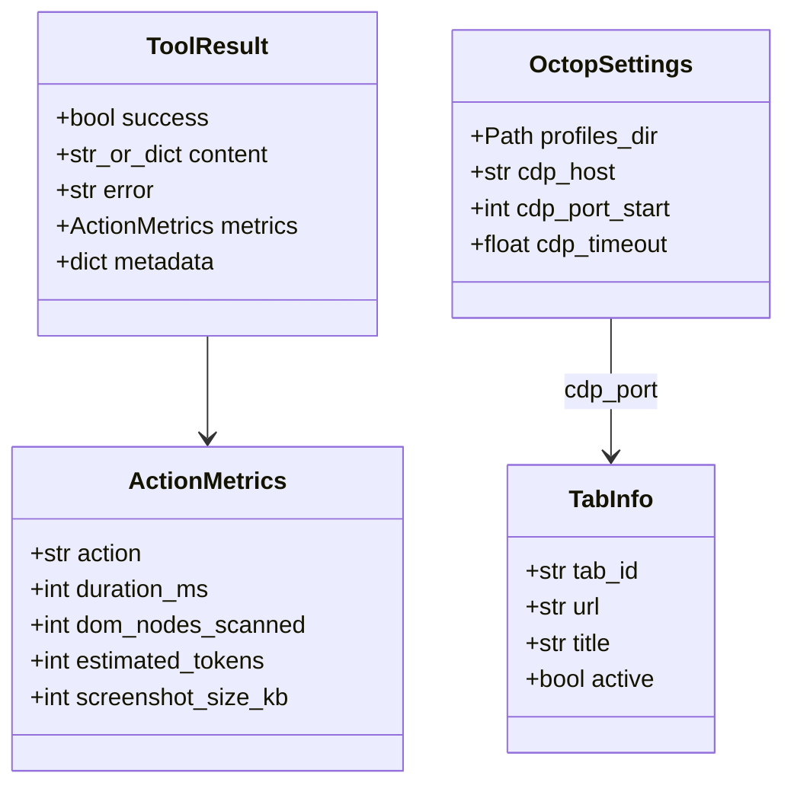

# 工具结果、指标与运行时配置值对象

`ToolResult` 是 `BrowserSession` 每个方法与 `browser_tool()` 的唯一返回类型，内嵌 `ActionMetrics`，可携带 `metadata` 旁路字典；`TabInfo` 描述单个页目标；`OctopSettings` 是 14 个字段的环境驱动运行参数对象。三者均为 Pydantic/dataclass 值对象，不落库，生命周期与单次动作或进程一致。

## 1. 实体与存储关系图

## 2. 精确字段字典（Exact Schema Dictionary）

### 2.1 `ActionMetrics`（`src/octop_browser/models.py:10`）

| 字段 | 类型 | 必填 / 默认 | 约束与含义 | 定义锚点 |
|---|---|---|---|---|
| `action` | `str` | 必填 | 动作名，与 `_KNOWN_ACTIONS` 一致 | `:13` |
| `duration_ms` | `int` | 必填 | `int((time.monotonic() - start) * 1000)` | `src/octop_browser/session.py:330` |
| `dom_nodes_scanned` | `int` | 必填 | 多数动作填 `0`，交互动作填 `1`（`src/octop_browser/actions/interact.py:16`） | `:15` |
| `estimated_tokens` | `int` | 必填 | 文本类统一 `len(content) // 4`，导航类固定 `20`（`src/octop_browser/actions/navigate.py:21`） | `:16` |
| `screenshot_size_kb` | `int` | 默认 `0` | 仅 `screenshot` 填 `len(img_bytes) // 1024`（`src/octop_browser/actions/capture.py:225`） | `:17` |

### 2.2 `ToolResult`（`src/octop_browser/models.py:20`）

| 字段 | 类型 | 必填 / 默认 | 约束与含义 | 定义锚点 |
|---|---|---|---|---|
| `success` | `bool` | 必填 | `False` 时必须查 `error` | `:29` |
| `content` | `Union[str, dict[str, object]]` | 必填 | 主载荷：DOM 文本、截图路径、JS 返回值 | `:30` |
| `error` | `str \| None` | 默认 `None` | 成功时恒为 `None` | `:31` |
| `metrics` | `ActionMetrics` | 必填 | 内嵌指标对象 | `:32` |
| `metadata` | `dict[str, object] \| None` | 默认 `None` | `screenshot` 与 `list_tabs` 使用的旁路 | `:33` |

`content` 刻意允许 `dict`：结构化 DOM 与部分 `eval_js` 返回会走字典，`_format_result` 对非 `str` 走 `json.dumps`（`src/octop_browser/cli.py:509`），MCP 侧同样 `str(result.content)`（`src/octop_browser/mcp_server.py:476`）。

### 2.3 `TabInfo`（`src/octop_browser/models.py:36`）

| 字段 | 类型 | 必填 | 含义 | 构造位置 |
|---|---|---|---|---|
| `tab_id` | `str` | 必填 | `/json` 目标的 `id` | `src/octop_browser/session.py:822` |
| `url` | `str` | 必填 | `t.get("url", "")` | `:823` |
| `title` | `str` | 必填 | `t.get("title", "")` | `:824` |
| `active` | `bool` | 必填 | `t.get("id") == active_id` | `:825` |

### 2.4 `OctopSettings` 字段全集（`src/octop_browser/settings.py:110`）

| 字段 | 类型 | 默认值 | 环境变量 | 行号 |
|---|---|---|---|---|
| `profiles_dir` | `Path` | `state_dir()/profiles` | `BROWSER_USE_PROFILES_DIR` | `:128` |
| `screenshots_dir` | `Path` | `state_dir()/screenshots` | `BROWSER_USE_SCREENSHOTS_DIR` | `:133` |
| `cdp_host` | `str` | `localhost` | `BROWSER_USE_CDP_HOST` | `:139` |
| `cdp_port_start` | `int` | `9222` | `BROWSER_USE_CDP_PORT_START` | `:144` |
| `chrome_bin` | `str \| None` | `None` | `BROWSER_USE_CHROME_BIN` | `:147` |
| `cdp_timeout` | `float` | `30.0` | `BROWSER_USE_CDP_TIMEOUT` | `:150` |
| `launch_retries` | `int` | `20` | `BROWSER_USE_LAUNCH_RETRIES` | `:153` |
| `launch_delay` | `float` | `0.25` | `BROWSER_USE_LAUNCH_DELAY` | `:156` |
| `cdp_ws_url` | `str \| None` | `None` | `BROWSER_USE_CDP_WS_URL` | `:159` |
| `idle_timeout_minutes` | `float` | `0.0` | `BROWSER_USE_IDLE_TIMEOUT_MINUTES` | `:162` |
| `viewport_width` / `viewport_height` | `int` | `1440` / `900` | `BROWSER_USE_VIEWPORT_WIDTH` / `HEIGHT` | `:165`、`:168` |
| `cdp_max_message_size` | `int \| None` | `33554432`（`0` → `None`） | `BROWSER_USE_CDP_MAX_MESSAGE_SIZE` | `:171` |
| `browser_mode` | `BrowserMode` | `auto` | `BROWSER_USE_MODE` | `:178` |

## 3. 全库存储介质与读写归属矩阵

| 载体 | 权威写入方 | 读取消费方 | 并发与原子性 |
|---|---|---|---|
| `ToolResult` 实例 | 各 `BrowserSession` 方法与 `_error_result`（`src/octop_browser/tool_interface.py:46`） | `_format_result`（`src/octop_browser/cli.py:502`）、`call_tool`（`src/octop_browser/mcp_server.py:475`） | 每动作新建，无共享 |
| `ActionMetrics` 累计量 | `BrowserSession._record`（`src/octop_browser/session.py:895`） | `metrics_summary()`（`:875`） | 实例内累加，事件循环单线程 |
| `OctopSettings` 单例 | `settings = OctopSettings()`（`src/octop_browser/settings.py:185`） | 全仓各模块 | import 时构造一次；单测用 `dataclasses.fields` 重置（`tests/unit/conftest.py:33`） |
| `_hooks` 回调表 | `HooksMixin.__init__`（`src/octop_browser/hooks.py:22`） | `_fire`（`:45`） | 回调异常被吞并记日志（`:52`） |

`metrics_summary()` 返回 4 键：`total_actions`、`total_duration_ms`、`total_estimated_tokens`、`errors`（`src/octop_browser/session.py:875`）。

## 4. 字段增删改共变清单（Schema Change Playbook）

- **改 `ToolResult` 字段**：`src/octop_browser/models.py:20` → `_error_result`（`src/octop_browser/tool_interface.py:46`）→ CLI `_format_result`（`src/octop_browser/cli.py:502`）→ MCP `call_tool`（`src/octop_browser/mcp_server.py:475`）→ `tests/unit/test_models.py` 与 [入向接口契约全集](../../contracts/api-reference.md)。
- **改 `ActionMetrics` 字段**：所有构造点（`src/octop_browser/session.py:328`、`src/octop_browser/actions/interact.py:12`、`src/octop_browser/actions/navigate.py:16`、`src/octop_browser/actions/capture.py:220`）与 `_record` 累计（`:895`）同步。
- **改 `OctopSettings` 字段**：`default_factory`（`src/octop_browser/settings.py:128`）、`tests/unit/conftest.py` 的字段重置循环（`tests/unit/conftest.py:33`）、[配置手册](../../contracts/configuration.md) 三处联动；新增字段必须提供环境变量键，否则单测隔离会漏删。
- **改 `TabInfo`**：`list_tabs` 构造（`:821`）与 `metadata.tabs` 序列化（`:846`）成对修改。
