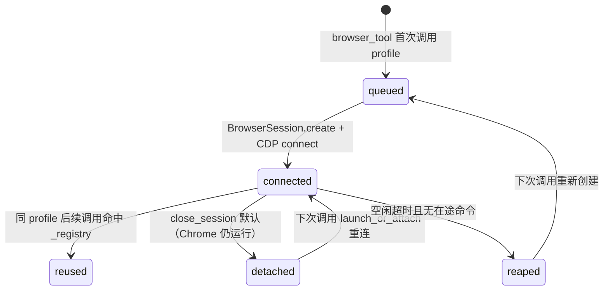

# `WF-01` · 无状态工具调用与会话复用

调用方以 `action + profile` 发起一次性请求；入口按 profile 惰性创建或复用 `BrowserSession`，把 action 反射到会话方法，最终经 CDP 驱动 Chrome。结果是「短命令、长会话」：CLI 进程退出后 Chrome 仍驻留，后续命令重连同一页面。

## 1. 符号级端到端执行调用树

```text
Trigger: CLI/Python/MCP -> src/octop_browser/tool_interface.py:91 browser_tool(action, profile, ...)
  ├─ [Step 1: 动作准入] action in _KNOWN_ACTIONS ? 否则 _error_result : :120-123
  ├─ [Step 2: 特殊分支] close_session -> 弹注册表 + 可选 terminate_browser : :125-161
  ├─ [Step 3: 会话获取] _get_or_create_session(profile) : :57-68
  │    └─ BrowserSession.create() -> pm.get_or_create(profile) -> internal.connect() : session.py:198-250
  │         └─ launch_or_attach + get_page_ws_url : session.py:55-72
  ├─ [Step 4: 会话已存在补 URL] urls[0] navigate，其余 new_tab(force_new) : :170-177
  ├─ [Step 5: 反射执行] getattr(sess, action)(**kwargs) : :179-182
  │    └─ BrowserSession.click -> _fire(before_action) -> interact.click -> _record : session.py:377-394
  └─ [Step 6: 失败自愈] 断链 -> _drop_session + 重建后重试一次 : :185-210
```

`_fire(before_action)` 的异常会被 hook 系统记日志而不阻断动作（`src/octop_browser/hooks.py:45-53`）；`_record()` 累计 4 项指标并按成功与否派发 `after_action` / `action_error`（`src/octop_browser/session.py:895-903`）。动作可点击的 ref 由 `DOMBuilder` 在遍历 CDP DOM 时按标签前缀生成并写入缓存（`src/octop_browser/dom/builder.py:124-134,229-230`）。

## 2. 分阶段业务规则与精确阈值

| 阶段 | 负责函数（`路径:行号`） | 精确布尔条件 / 阈值 | 命中分支行为 | 副作用 |
|---|---|---|---|---|
| 动作白名单 | `browser_tool` (`src/octop_browser/tool_interface.py:120-123`) | `action not in _KNOWN_ACTIONS`（19 个合法值） | 返回 `success=False`，错误文案含排序后的合法集合 | 无 |
| 关闭会话 | `browser_tool` (`src/octop_browser/tool_interface.py:125-161`) | `action == "close_session"` 且残留 kwargs 非空 | 返回 `Invalid parameters for 'close_session'` | 无 |
| 断链判定 | `_is_disconnected_error` (`src/octop_browser/tool_interface.py:83-88`) | `CDPSessionError` 且消息含 `not connected` 或 `connection lost` | 丢弃会话、重建、最多重试 1 次 | 旧 CDP 连接关闭 |
| 启动模式优先级 | `BrowserSession.create` (`src/octop_browser/session.py:231-235`) | `headless is not None` > `mode` > `cfg.browser_mode` | 决定 `--headless=new` 是否加入 argv | Chrome 进程参数 |
| 导航清 ref | `navigate` (`src/octop_browser/actions/navigate.py:25-28`) | 无条件 | `ref_cache.invalidate()` 先于 `Page.navigate` | 旧 ref 全部失效 |
| 加载等待 | `navigate` (`src/octop_browser/actions/navigate.py:13,47-49`) | `asyncio.wait_for(load_event, timeout=5.0)` 超时 | 吞掉超时，动作仍成功 | 监听器 `off()` 注销 |
| 坐标解析 | `_resolve_coords` (`src/octop_browser/actions/interact.py:40-60`) | `ref` / `selector` / `(x,y)` 三者按序；都没有 | 抛 `ValueError("Must provide ref, selector, or (x, y)")` | 无 CDP 调用 |
| 空闲回收 | `BrowserIdleController._check_once` (`src/octop_browser/idle.py:98-109`) | `_reaped or _active_commands` 为真则跳过；否则 `idle_for >= timeout_seconds` | 调用 `reap_now()` 终止 Chrome | 会话注册表同步移除 |

## 3. 实体状态机与合法迁移



**不可违反的约束**：`detached` 与 `reaped` 都清掉 `_registry` 条目，但只有 `kill=True` 或空闲回收才终止 Chrome（`src/octop_browser/tool_interface.py:132-151`、`src/octop_browser/idle.py:70-96`）。Profile 的端口与目标 target 通过磁盘文件黏性保存，跨进程不丢（`src/octop_browser/profile.py:49-92`）。

## 4. 幂等、并发与异常补偿

| 边界/故障场景 | 检测条件（`路径:行号`） | 保护/回滚动作 |
|---|---|---|
| 同 profile 并发调用 | `_registry` 字典无锁（`src/octop_browser/tool_interface.py:17`） | 当前实现依赖事件循环单线程串行，不提供跨进程互斥；多进程需各自独立 profile |
| CDP 断链 | `_is_disconnected_error` (`:83-88`) | `_drop_session()` 后重建一次；二次失败返回错误结果 |
| 新建标签导航失败 | `navigation_result.success is False` (`src/octop_browser/session.py:614-630`) | 切回旧 target 并 `Target.closeTarget` 清理新标签 |
| Chrome 启动后立即退出 | `_get_ws_url` 的 `process.poll()` (`src/octop_browser/cdp/launcher.py:374-380`) | 立即抛错并附 stderr tail，不耗尽重试预算 |
| SingletonLock 冲突 | 错误文案含 `ProcessSingleton`/`SingletonLock`/`returncode=21` (`src/octop_browser/cdp/launcher.py:583-595`) | 旧的目录改名 `*.stale-<ts>` 后重试一次 |
| 空闲回收失败 | `terminate_browser()` 返回 False (`src/octop_browser/idle.py:86-89`) | 重置 `_last_activity` 延后一个检查周期再试 |

## 5. 共变耦合与修改清单

1. 新增动作：`BrowserSession` 方法 → `_KNOWN_ACTIONS`（`src/octop_browser/tool_interface.py:20-43`）→ CLI/MCP 两侧 → `../contracts/api-reference.md`。
2. 改会话复用策略：影响 `BROWSER_USE_IDLE_TIMEOUT_MINUTES` 语义，同步 `../contracts/configuration.md` 与 `tests/unit/test_idle.py`。
3. 改导航行为：必须保留 `RefCache.invalidate()`，否则 `../integrations/downstream/chrome-cdp.md` 中的 ref 契约失效；跑 `tests/unit/test_navigate_actions.py`。
4. 必跑闭环回归：`pytest tests/unit/test_tool_interface.py tests/integration/test_session.py`。

## 6. 关联文档

- [业务流程总表](index.md) · [Chrome CDP 出向契约](../integrations/downstream/chrome-cdp.md) · [模块依赖矩阵](../architecture/module-dep-matrix.md)
