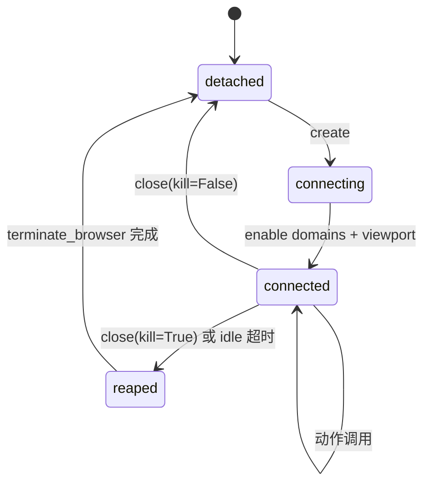

# WF-01 · 浏览器会话创建、连接与关闭闭环

触发条件为任意 `browser_tool` 首次按 `profile` 调用、`BrowserSession.create()` 或 CLI/MCP 首个动作；目标是得到一条绑定真实 Chrome 页面的 CDP 会话，并在 `close(kill=)` 时按语义决定仅断开还是连进程一起回收。同步执行，产物是内存中的 `_InternalCDPSession` 与磁盘上的 profile 端口/目标状态文件。

## 1. 符号级端到端执行调用树

```text
Trigger: browser_tool(action, profile) 首次调用 -> _get_or_create_session (src/octop_browser/tool_interface.py:57)
  └─ BrowserSession.create(profile, headless, mode, urls, settings) (src/octop_browser/session.py:198)
       ├─ [Step 1 配置] cfg = settings or _default_settings; pm = profile_manager or _default_profile_manager (:226)
       ├─ [Step 2 profile] pm.get_or_create(profile) -> data_dir + cdp_port (src/octop_browser/profile.py:165)
       │    └─ _assign_port: 读 .octop-browser-profiles.json，冲突则端口自增 (src/octop_browser/profile.py:151)
       ├─ [Step 3 模式] headless is not None ? headless : resolve_headless(normalize_mode(mode) or cfg.browser_mode) (:231)
       │    └─ auto -> has_desktop_environment() 读 DISPLAY / WAYLAND_DISPLAY (src/octop_browser/mode.py:43)
       ├─ [Step 4 连接] _InternalCDPSession.connect(headless=is_headless) (src/octop_browser/session.py:49)
       │    ├─ [if cfg.cdp_ws_url] 直连远端 WS，跳过 launcher (:55)
       │    └─ [else] launch_or_attach(profile, headless) + get_page_ws_url(port, profile) (:59)
       │         └─ Popen + _get_ws_url 轮询 /json/version (src/octop_browser/cdp/launcher.py:497)
       ├─ [Step 5 使能] enable_domain("Page"/"DOM"/"Runtime") (:64)
       ├─ [Step 6 视口] _apply_viewport -> Emulation.setDeviceMetricsOverride (:74)
       ├─ [Step 7 空闲守护] idle_controller.start()（仅本地 host 且超时>0）(:71)
       └─ [Step 8 多标签] urls 非空时首 URL navigate、其余 new_tab(force_new=True) (:241)

close(kill=False) (src/octop_browser/session.py:887)
  └─ _InternalCDPSession.close(kill) (src/octop_browser/session.py:149)
       ├─ await self._client.close() (:150)
       └─ [if kill] idle_controller.reap_now() 或 terminate_browser(profile, cdp_host) (:152)
```

## 2. 分阶段业务规则与分支判定表

| 阶段 | 负责函数（`路径:行号`） | 精确布尔条件 / 阈值 | 命中分支行为 | 状态或数据副作用 |
|---|---|---|---|---|
| 模式优先级 | `BrowserSession.create` (`src/octop_browser/session.py:231`) | `headless is not None` > `mode` 参数 > `cfg.browser_mode` | 显式 `headless` 完全覆盖另两者 | 决定 `--headless=new` 是否追加 |
| 模式合法性 | `normalize_mode` (`src/octop_browser/mode.py:26`) | `value` 不在 `auto/headed/headless` | 抛 `ValueError("Invalid browser mode ...")` | 会话创建失败，无写入 |
| 桌面环境判定 | `has_desktop_environment` (`src/octop_browser/mode.py:43`) | macOS/Windows 恒真；Linux 需 `DISPLAY` 或 `WAYLAND_DISPLAY` | `auto` 据此取反得 headless | 仅日志 debug |
| 直连旁路 | `_InternalCDPSession.connect` (`src/octop_browser/session.py:55`) | `cfg.cdp_ws_url` 非空 | 跳过 `launch_or_attach`，直接 `client.connect(ws_url)` | 后续 `switch_to_target` 被禁用（`:107`） |
| 端口分配 | `_assign_port` (`src/octop_browser/profile.py:151`) | 端口已在 `ports.values()` 或 `_profiles` 中 | `while port in used_ports: port += 1` | 整文件写回 `.octop-browser-profiles.json` |
| 目标粘性 | `get_page_ws_url` (`src/octop_browser/cdp/launcher.py:618`) | `profile.load_target()` 命中存活 page | 复用该 `webSocketDebuggerUrl`，否则清空缓存并取首个非空白页 | `profile.save_target(target_id)`（`:669`） |
| 空闲守护准入 | `idle_controller_for` (`src/octop_browser/idle.py:132`) | `timeout_seconds <= 0` 或 `cfg.cdp_ws_url` 或 `cdp_host` 非本地 | 返回 `None`，不启守护任务 | 无 `BrowserIdleController` |
| 视口兜底 | `_apply_viewport` (`src/octop_browser/session.py:83`) | `max(int(cfg.viewport_width), 1)` | 宽高最小为 1，异常仅 debug 日志 | 发 `Emulation.setDeviceMetricsOverride` |

## 3. 实体状态机与合法迁移约束



- **不可违反的业务不变量**：`_connected` 仅在 `connect` 成功后置 `True`（`src/octop_browser/session.py:70`）；`close` 先关 client 再置 `False`（`:150`），任何绕过该顺序的改动会让后续 `send` 拿到 `Not connected` 异常。
- **跨进程粘性不变量**：CLI 每次是独立进程，靠 `.octop-browser-target.json` 保证连续命令附着同一标签（`src/octop_browser/profile.py:49`），删除该文件会退化为启发式选页。
- **登录态不变量**：同一 `profile` 名固定映射到同一 `--user-data-dir`（`src/octop_browser/profile.py:169`），禁止为 cookie/auth 另造路径。

## 4. 幂等、并发互斥与异常补偿回滚表

| 边界 / 故障场景 | 源码检测条件 | 保护 / 回滚 / 降级动作 |
|---|---|---|
| 同 profile 并发首次调用 | `_registry` 字典查找（`src/octop_browser/tool_interface.py:63`） | 未命中即 `await BrowserSession.create`，无显式锁，依赖事件循环单线程 |
| Chrome 已在端口服务 | `_port_in_use(profile.cdp_port)`（`src/octop_browser/cdp/launcher.py:508`） | 直接 `_get_ws_url` 附着，不重复 `Popen` |
| Chrome 启动即退出 | `process.poll() is not None`（`:374`） | 抛带 stderr 尾部的 `RuntimeError`，不做无限重试 |
| `ProcessSingleton` 冲突 | stderr 含 `returncode=21` / `SingletonLock`（`:585`） | `recover_profile` 重命名旧目录并重试一次 `Popen` |
| CDP 连接断开 | 异常文本含 `not connected` 或 `connection lost`（`src/octop_browser/tool_interface.py:83`） | `_drop_session` 后重建会话重试一次（`:186`） |
| `close(kill=True)` 且远端 WS | `cfg.cdp_ws_url` 非空（`src/octop_browser/session.py:155`） | 不调用 `terminate_browser`，仅关闭 WebSocket |

## 5. 共变耦合与修改清单（Agent Co-Change Playbook）

- **修改模式解析**：`BrowserSession.create`（`src/octop_browser/session.py:231`）、`normalize_mode`（`src/octop_browser/mode.py:26`）、`_build_flags` 的 `--headless=new` 分支（`src/octop_browser/cdp/launcher.py:221`）与 [配置手册](../contracts/configuration.md) 联动。
- **修改 profile 端口/目标状态**：`ProfileManager`（`src/octop_browser/profile.py:95`）、`get_page_ws_url` 的 sticky 分支（`src/octop_browser/cdp/launcher.py:653`）与 [标签管理](wf-tab-management.md) 成对核查。
- **修改空闲回收**：`idle_controller_for` 准入条件（`src/octop_browser/idle.py:132`）与 `CDPClient.send` 的 activity 钩子（`src/octop_browser/cdp/client.py:85`）必须一致，否则「真实活动」定义漂移。
- **必跑流程闭环回归**：`pytest tests/integration/test_session.py tests/unit/test_mode.py tests/unit/test_settings.py tests/unit/test_profile.py`，命令见 [构建与单测映射](../operations/dev-and-test.md)。
