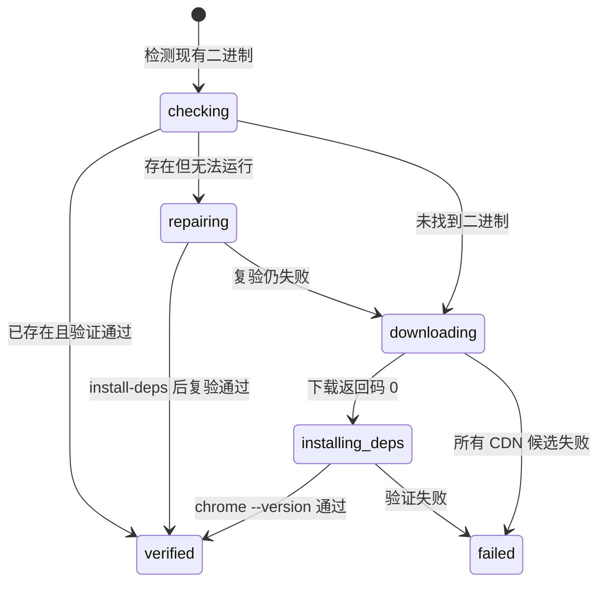

# `WF-03` · Chromium 引导安装与验证

首次使用时把 Chromium 二进制拉入 Playwright 标准缓存并补齐系统依赖。该流程是唯一会在宿主机器上执行 `pip install` 与包管理器安装的业务，任何失败都必须以 `chrome --version` 验证结果为准。

## 1. 符号级端到端执行调用树

```text
Trigger: CLI install-browser -> src/octop_browser/cli.py:637-643
       或 MCP install_browser -> src/octop_browser/mcp_server.py:372-388
  ├─ [Step 1: 幂等短路] chromium_executable() 存在 -> 打印路径，退出 0 : cli.py:638-641
  ├─ [Step 2: 二进制定位] _find_playwright_chromium() 扫描 PLAYWRIGHT_BROWSERS_PATH / 平台缓存 : src/octop_browser/cdp/launcher.py:84-123
  ├─ [Step 3: pip 引导] _playwright_available() 为假 -> _run_pip_install() : install.py:316-330
  │    └─ [guard] OCTOP_SKIP_PLAYWRIGHT_PIP=1 -> 直接失败并提示手工安装 : :317-325
  ├─ [Step 4: CDN 竞速] race_download_sources(build_download_candidates()) : :332
  │    ├─ custom / npmmirror / official 三候选并发探测 TTFB : playwright_download.py:46-148
  │    └─ 逐候选 python -m playwright install chromium : install.py:339-356
  ├─ [Step 5: 系统依赖] _run_install_deps() -> build_install_steps() : install.py:361,186-222
  │    └─ 库步骤首个成功即停；字体步骤 optional : linux_deps.py:220-285
  └─ [Step 6: 验证门禁] verify_chromium() -> [exe, "--version"] timeout=10 : install.py:364-369
       └─ 失败 -> 返回 False / 流式 done+success=false 与精确诊断 : :365-369,618-620
```

流式分支 `install_chromium_stream()` 额外处理「二进制存在但坏」的路径：先尝试 install-deps 再复验，仍失败才进入全量下载（`src/octop_browser/install.py:519-534`）。

## 2. 分阶段业务规则与精确阈值

| 阶段 | 负责函数（`路径:行号`） | 精确布尔条件 / 阈值 | 命中分支行为 | 副作用 |
|---|---|---|---|---|
| 幂等判定 | CLI `main` (`src/octop_browser/cli.py:638-641`) | `chromium_executable() is not None` | 不下载，直接退出 0 | 无 |
| pip 探测 | `_playwright_available` (`src/octop_browser/install.py:108-120`) | `importlib.util.find_spec("playwright") is None`；先 `invalidate_caches()` | 需要引导安装 | 避免在进程内真正 import 重包 |
| 引导跳过 | `_skip_pip_bootstrap` (`src/octop_browser/install.py:123-125`) | `OCTOP_SKIP_PLAYWRIGHT_PIP` 或旧名值 ∈ {1,true,yes,on} | 阻断安装，返回明确指引 | 无 |
| 多 pip 策略 | `_multi_pip_bootstrap_enabled` (`src/octop_browser/install.py:145-149`) | `OCTOP_MULTI_PIP_BOOTSTRAP` 真值 | 真则依次试 uv 与 python -m pip，假只试第一条 | 子进程安装 |
| 探测超时 | `probe_source` (`src/octop_browser/playwright_download.py:20,83-105`) | 4.0s；5xx 抛错；4xx 容忍 | 失败候选被剔出竞速排序 | 无 |
| 竞速并发 | `race_download_sources` (`src/octop_browser/playwright_download.py:122-148`) | `max_workers = min(len(candidates), 3)`；按 TTFB 升序 | 胜出者优先下载 | 日志记 `race winner=...` |
| 包管理器选择 | `detect_package_manager` (`src/octop_browser/linux_deps.py:182-187`) | 按 `apt-get→dnf→yum→zypper→pacman→apk` 取首个 PATH 命中 | 决定安装命令前缀与包集合 | 子进程安装 |
| 提权策略 | `with_privileges` (`src/octop_browser/linux_deps.py:190-206`) | 非 root 且有 sudo → 前缀 `sudo -n --` | 密码型 sudo 立即失败，不等待 TTY | 无 |
| 验证门禁 | `verify_chromium` (`src/octop_browser/install.py:230-272`) | 返回码 0 成功；127 或 stderr 含 `shared libraries` 给缺库提示；超时 10s | 唯一决定整体成败 | 无 |

## 3. 实体状态机与合法迁移



**不可违反的约束**：系统依赖安装是 best-effort，失败也要继续到验证步骤，以便给出精确的缺库诊断（`src/octop_browser/install.py:360-369`）；字体包永远 optional（`src/octop_browser/linux_deps.py:263-285`）。

## 4. 幂等、并发互斥与异常补偿

| 边界/故障场景 | 检测条件（`路径:行号`） | 保护/回滚动作 |
|---|---|---|
| 重复安装 | `chromium_executable()` 非空且验证通过 (`src/octop_browser/install.py:293-300`) | 短路返回，不触碰 Pip/CDN |
| pip 安装失败 | `_run_pip_install()` 全候选返回非 0 (`src/octop_browser/install.py:152-175`) | 返回 False；流式发终态失败事件 (`:567-571`) |
| CDN 全失败 | `ordered` 中所有子进程返回非 0 (`src/octop_browser/install.py:357-358,600-602`) | 同步返回 False / 流式发 `error="Chromium download failed"` |
| 消费者断开 | `is_disconnected()` 返回真 (`src/octop_browser/install.py:400-407`) | `proc.kill()` 后立即结束流，不留孤儿安装进程 |
| 验证超时 | `subprocess.TimeoutExpired` (`src/octop_browser/install.py:247-248`) | `(False, "Chromium verification timed out")` |
| 缺系统库 | 返回码 127 或 stderr 含 `.so` (`src/octop_browser/install.py:256-267`) | 从 stderr 提取首个库名，附 `manual_hint()` |

## 5. 共变耦合与修改清单

1. 改下载候选或探测头：同步 `../integrations/downstream/playwright-cdn.md` 与 `../contracts/configuration.md`，跑 `tests/unit/test_playwright_download.py`。
2. 改安装步骤顺序：`linux_deps.py` 的 `InstallStep.optional` 语义决定失败是否翻转结果，跑 `tests/unit/test_linux_deps.py` 与 `tests/unit/test_install.py`。
3. 改 CLI 幂等输出：同步 `../contracts/api/cli-commands.md` 与 `tests/unit/test_cli.py`。
4. 改事件字典：MCP 聚合逻辑只识别 `log/done/success/error`（`src/octop_browser/mcp_server.py:372-388`），新增字段需同步；禁止在日志中回显任何凭据。

## 6. 关联文档

- [业务流程总表](index.md) · [CDN 出向契约](../integrations/downstream/playwright-cdn.md) · [安装引导组件](../architecture/install-bootstrap.md)
