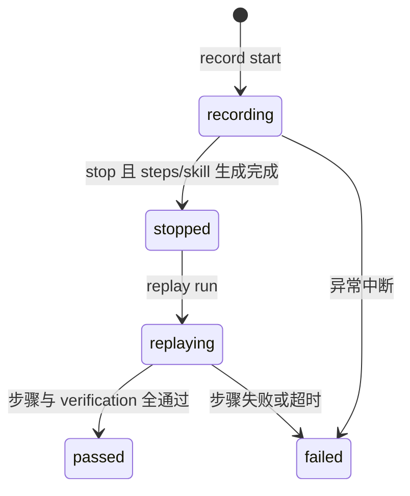

# `WF-02` · 录制、语义折叠与 Skill 引导回放

用户先录一段真实浏览过程，系统把原始浏览器事件折叠成语义意图并可选择生成 Skill 草稿；回放时按意图重新驱动浏览器，用实时 DOM 重新匹配目标，而不是重放录制时的坐标或 ref。

## 1. 符号级端到端执行调用树

```text
Trigger: CLI record start / MCP browser_record_start -> src/octop_browser/cli.py:557-585
  ├─ [Step 1: daemon 准入] ensure_daemon() -> send_request({"command":"start",...}) : daemon.py:190-198,140-165
  │    └─ [guard] active 已存在 -> 拒绝 "A recording is already active" : :43-63
  ├─ [Step 2: 建会话] RecordController.start_in_process() : recorder.py:350-395
  │    ├─ _attach(profile) -> CDP page websocket : :331-339
  │    ├─ RecordingStore.create() 建目录树 : :378, store.py:45-62
  │    └─ RecordSession.start() 注入 JS + 绑定多标签 : :83-99
  ├─ [Step 3: 事件上行] JS emit -> Runtime.bindingCalled -> _on_binding_called : :256-286
  │    ├─ [guard] 字节数 > max_event_bytes / 每秒 > max_events_per_second -> 丢 : :232-238,263-268
  │    ├─ [guard] nonce 不符 -> 丢 : :273-274
  │    └─ redact_event -> append_event -> manifest.stats.events++ : :240-254
  ├─ [Step 4: 停止并折叠] RecordSession.stop(generate_steps=True) : :101-134
  │    ├─ SemanticProcessor.process() -> _filter_events/_build_steps/_infer_variables : semantic.py:338-351
  │    └─ SkillGenerator.generate() -> draft.skill.md : skill_generator.py:32-99
  └─ [Step 5: 回放] ReplayRunner.run() : replay.py:25-298
       ├─ 每步 browser_tool(navigate/new_tab/click/fill/...) : :53-268
       ├─ match_target(step.target, structured DOM) 阈值 45 : matcher.py:19-62
       ├─ [失败] _capture_failure_artifacts 写 reason/dom/screenshot : replay.py:425-467
       └─ _run_verification() 按 type 分派 wait / eval_js : :329-423
```

## 2. 分阶段业务规则与精确阈值

| 阶段 | 负责函数（`路径:行号`） | 精确布尔条件 / 阈值 | 命中分支行为 | 副作用 |
|---|---|---|---|---|
| 并发录制互斥 | `RecordDaemon.dispatch` (`src/octop_browser/record/daemon.py:43-49`) | `self.active is not None` | 返回 `ok=False` 和当前活动信息 | 无 |
| 录制 ID 冲突核对 | `RecordDaemon.dispatch` (`src/octop_browser/record/daemon.py:67-72`) | `rec_id` 非空且不等于当前 `manifest.recording_id` | 拒绝 stop，提示实际活动 ID | 无 |
| 事件体积上限 | `RecordSession._on_binding_called` (`src/octop_browser/record/recorder.py:263-268`) | `len(raw.encode("utf-8")) > max_event_bytes`（默认 65536） | 静默丢弃该事件 | events 计数不增 |
| 事件速率上限 | `RecordSession._rate_limit_ok` (`src/octop_browser/record/recorder.py:232-238`) | 同一整数秒内 `_tick_events > max_events_per_second`（默认 100） | 丢弃 | events 计数不增 |
| 空白页点击改写 | `SemanticProcessor._build_steps` (`src/octop_browser/record/semantic.py:419-443`) | `kind=click` 且 `url=about:blank` 且下一条是 navigation 类 | 合并为 `navigate` 步骤并跳过两条 | 减少不可重放步骤 |
| 低信号点击过滤 | `_is_low_signal_result_click` (`src/octop_browser/record/semantic.py:277-316`) | 非交互 role/tag 且文本长度 ≥160，或所有选择器含 `nth-of-type` | 丢弃该 click | 保留前序搜索/导航意图 |
| 目标匹配阈值 | `match_target` (`src/octop_browser/record/matcher.py:19-62`) | selector +80、id +70、nameAttr +60、name +50、role +25、partial-name +20；总分 ≥45 命中 | 低于 45 返回 `not-found` | 失败留证 |
| 回放步数下限 | `ReplayRunner.run` (`src/octop_browser/record/replay.py:281-284`) | 过滤 skipped 后执行步数为 0 | 抛 `Recording has no executable steps` | 报告置 failed |
| 验证码/风控跳转 | `is_transient_auth_or_risk_url` (`src/octop_browser/record/url_filter.py:11-41`) | 微博 visitor/newlogin、百度 captcha、小红书 login/error 四类 | 步骤标 `skipped`，reason 为 `transient_auth_or_risk_redirect` | 不中断回放 |

## 3. 实体状态机与合法迁移



**不可违反的业务不变量**：`recorder.js` 通过 `__hbrRecorderInstalled` 防止同一 recordingId 重复注入（`src/octop_browser/record/injected/recorder.js:4-6`）；daemon 关闭时若仍有活动录制，必须自动 stop 并生成步骤后才关服（`src/octop_browser/record/daemon.py:84-90`）。

## 4. 幂等、并发互斥与异常补偿

| 边界/故障场景 | 检测条件（`路径:行号`） | 保护/回滚/降级动作 |
|---|---|---|
| daemon 未启动 | `send_request` 捕获 OSError/Timeout (`src/octop_browser/record/daemon.py:148-159`) | 返回可操作错误「Start it with `octop-browser record daemon-start`」 |
| daemon 启动轮询失败 | `ensure_daemon()` 30×0.1s 仍不可达 (`src/octop_browser/record/daemon.py:190-198`) | 返回 `ok=False` 并附 pid/socket 便于排查 |
| 新标签 id 映射 | `target_map[recorded_id] = new_tab_id` (`src/octop_browser/record/replay.py:66-83`) | 后续步骤先 `switch_tab`，即便目标看似当前也强制激活 (`:307-327`) |
| 目标匹配失败 | `match_target` 返回 None (`src/octop_browser/record/replay.py:154-180`) | 依次尝试 selector/xpath JS 与 bbox 坐标回退 (`:469-497`)，仍失败则写失败工件并终止 |
| 回放超时 | `wait(timeout_ms=10000)` 失败 (`src/octop_browser/record/replay.py:189-199,341-347`) | 步骤标 failed，进入失败留证分支 |
| 脱敏值注入 | `_resolve_value()` 查 inputs 缺失 (`src/octop_browser/record/replay.py:566-570`) | 回填空串，不抛异常、不回显原敏感值 |

## 5. 共变耦合与修改清单

1. 新增 JS 事件类型：`recorder.js` 的 `emit()` → `_filter_events()` 白名单（`src/octop_browser/record/semantic.py:353-370`）→ `_build_steps()` → `ReplayRunner.run()` 分发。
2. 改 `steps.json` 字段：同步 `StepsDocument`/`SemanticStep`（`src/octop_browser/record/models.py:69-88`）、Skill 生成器（`src/octop_browser/record/skill_generator.py:113-187`）与 `domain-models/index.md`。
3. 改脱敏正则：`SENSITIVE_RE` 与 `URL_KEYS` 在 Python（`src/octop_browser/record/privacy.py:11-24`）与注入 JS（`src/octop_browser/record/injected/recorder.js:13-17`）两处各有一份，必须同步。
4. 必跑闭环回归：`pytest tests/unit/test_record_replay_semantic.py tests/unit/test_record_replay_replay_runner.py tests/unit/test_record_daemon_client.py`；真实浏览器闭环跑 `scripts/record_replay_smoke.py` 与 `pytest tests/integration/test_record_replay_e2e.py`。

## 6. 关联文档

- [业务流程总表](index.md) · [录制回放 Worker](../architecture/record-worker.md) · [核心数据模型](domain-models/index.md)
