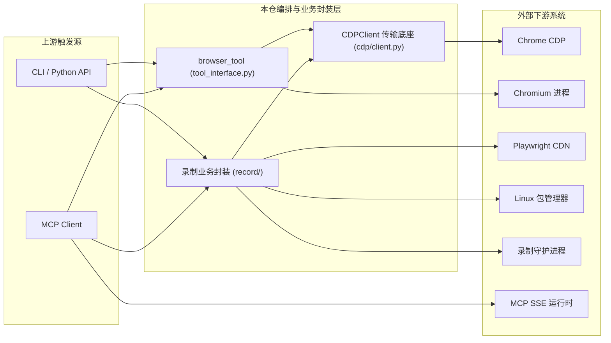

# 上下游集成与调用拓扑总览

汇总本仓全部组件「上游被谁调 ↔ 下游调了谁」的双向拓扑，并完整登记 6 个外部下游依赖系统的业务封装入口。强制区分**传输底座**（`CDPClient`、`aiohttp`、`subprocess`）与**业务封装层**（组装什么请求字典、解包什么返回键）；后者一律在 `downstream/<target>.md` 独立成篇，禁止只登记底座而漏掉字典层。

## 1. 上下游调用拓扑图（Inbound ↔ Internal ↔ Outbound）

## 2. 仓内组件「上游有谁 ↔ 下游调谁」双向速查表

| 本仓组件 / 模块 | 源码路径 | 直接上游调用方（符号 + `路径:行号`） | 调用的仓内下游模块 | 调用的外部下游封装 | 组件架构页 |
|---|---|---|---|---|---|
| `browser_tool` | `src/octop_browser/tool_interface.py` | `cli._run_action` (`src/octop_browser/cli.py:523`)、`mcp_server.call_tool` (`src/octop_browser/mcp_server.py:475`)、`ReplayRunner.run` (`src/octop_browser/record/replay.py:56`) | `BrowserSession`、`ProfileManager` | [Chrome CDP](downstream/chrome-cdp.md)、[Chromium 进程](downstream/chromium-process.md) | [mcp-server.md](../architecture/mcp-server.md) |
| `BrowserSession` | `src/octop_browser/session.py` | `browser_tool` (`src/octop_browser/tool_interface.py:180`) | `actions/`、`dom/`、`CDPClient` | [Chrome CDP](downstream/chrome-cdp.md) | [browser-session-engine.md](../architecture/browser-session-engine.md) |
| `CDPClient` | `src/octop_browser/cdp/client.py` | `session.py`、`actions/*`、`record/recorder.py` | 无（最底层） | Chrome WebSocket | [chrome-cdp.md](downstream/chrome-cdp.md) |
| `launch_or_attach` | `src/octop_browser/cdp/launcher.py` | `_InternalCDPSession.connect` (`src/octop_browser/session.py:59`)、`RecordController._attach` (`src/octop_browser/record/recorder.py:336`) | `launch_prep.py`、`profile.py` | Chromium 进程、`aiohttp /json` | [chromium-process.md](downstream/chromium-process.md) |
| `RecordDaemon` / `RecordSession` | `src/octop_browser/record/daemon.py`、`recorder.py` | `cli._run_record` (`src/octop_browser/cli.py:577`)、`mcp_server.call_tool` (`src/octop_browser/mcp_server.py:405`) | `RecordingStore`、`SemanticProcessor` | [录制守护 IPC](downstream/record-daemon-ipc.md)、[Chrome CDP](downstream/chrome-cdp.md) | [record-daemon.md](../architecture/record-daemon.md) |
| `ReplayRunner` | `src/octop_browser/record/replay.py` | `cli._run_replay` (`src/octop_browser/cli.py:617`)、`mcp_server.call_tool` (`src/octop_browser/mcp_server.py:452`) | `browser_tool`、`match_target` | [Chrome CDP](downstream/chrome-cdp.md) | [wf-replay.md](../business/wf-replay.md) |
| 安装流水线 | `src/octop_browser/install.py` | `cli.main` (`src/octop_browser/cli.py:642`)、`_handle_install_browser` (`src/octop_browser/mcp_server.py:377`) | `linux_deps.py`、`playwright_download.py` | [Playwright 安装器](downstream/playwright-installer.md)、[Linux 系统依赖](downstream/linux-system-deps.md) | [wf-chromium-install.md](../business/wf-chromium-install.md) |
| `mcp_server._main` | `src/octop_browser/mcp_server.py` | `python -m octop_browser.mcp_server` (`Makefile:115`) | `app.run` | [MCP 传输](downstream/mcp-transport.md) | [mcp-server.md](../architecture/mcp-server.md) |

## 3. 外部下游依赖系统全量清单（Downstream Registry）

| 下游系统名 | 承担业务职责 | 协议与成功码判定 | 底层传输基类（`路径:行号`） | **本仓业务封装文件（组装参数层）** | 封装方法数 | 超时 / 重试配置 | 出向字典契约专页 |
|---|---|---|---|---|---|---|---|
| `chrome-cdp` | 驱动真实 Chrome 页面（导航、DOM、输入、截图、标签、注入） | CDP WebSocket 帧无 `error` 键 + `result` 内层字典；HTTP 200 | `CDPClient`（`src/octop_browser/cdp/client.py:30`）、`aiohttp.ClientSession`（`src/octop_browser/cdp/launcher.py:382`） | `actions/navigate.py`、`interact.py`、`js_eval.py`、`capture.py`、`session.py` | 17 类命令字 | `cdp_timeout=30.0`、`launch_retries=20` | [chrome-cdp.md](downstream/chrome-cdp.md) |
| `chromium-process` | 拉起/附着/关闭本地 Chrome，发现二进制 | `/json/version` 返回 `webSocketDebuggerUrl`；端口消失即关闭成功 | `subprocess.Popen`（`src/octop_browser/cdp/launcher.py:578`）、`aiohttp` | `cdp/launcher.py`、`cdp/launch_prep.py` | 7 个方法 | 轮询 `20 × 0.25s`、关闭 `3.0s` | [chromium-process.md](downstream/chromium-process.md) |
| `playwright-installer` | 一次性下载 Chromium 二进制 | `chrome --version` 返回码 0 | `subprocess.run` / `create_subprocess_exec`（`src/octop_browser/install.py:159`、`:385`）、`urllib` | `install.py`、`playwright_download.py` | 7 个方法 | 探测 `4.0s`、验证 `10s` | [playwright-installer.md](downstream/playwright-installer.md) |
| `linux-system-deps` | 安装 Chrome 共享库与 CJK 字体 | 包管理器 `returncode == 0` | `subprocess.run`（`src/octop_browser/install.py:208`） | `linux_deps.py` | 6 个方法 | `sudo -n --` 免挂起 | [linux-system-deps.md](downstream/linux-system-deps.md) |
| `record-daemon-ipc` | 跨进程录制控制（开始/停止/状态/关闭） | 应答 `ok` 为真 | `asyncio.open_unix_connection`（`src/octop_browser/record/daemon.py:149`） | `record/daemon.py` | 5 个命令 | `send_request(timeout=5.0)` | [record-daemon-ipc.md](downstream/record-daemon-ipc.md) |
| `mcp-transport` | stdio / SSE 承载 MCP 工具调用 | `TextContent(type="text")` 返回 | `stdio_server` / `SseServerTransport`（`src/octop_browser/mcp_server.py:527`、`:501`） | `mcp_server.py` | 5 个接口组 | uvicorn `log_level="info"` | [mcp-transport.md](downstream/mcp-transport.md) |

## 4. 底座与业务封装分层说明

`CDPClient`（`src/octop_browser/cdp/client.py:30`）只负责 `{"id","method","params"}` 帧的发送与 `result`/`error` 解包，**不组装任何业务字典**；真正决定 `Page.navigate {"url": ...}`、`Input.dispatchMouseEvent {"type","x","y","button","clickCount":1}`、`Page.captureScreenshot {"format":"png","clip":{...}}` 的是 `actions/` 与 `session.py`。同理 `subprocess.Popen` 只是执行器，argv 与环境字典由 `cdp/launcher.py:190` 与 `cdp/launch_prep.py:207` 组装；`asyncio.open_unix_connection` 只是连接，单行 JSON 请求由 `cli.py:549` 与 `mcp_server.py:406` 拼装。逐个字典 Key 见 [参数组装映射](topology-and-mapping.md) 与各 `downstream/*.md` 第 4 节。

## 5. 共变耦合与修改清单（Agent Co-Change Playbook）

- **新增下游系统**：在本页 §3 登记一行，并在 `downstream/<target>.md` 独立成篇展开完整请求/返回字典；只补底座层而不补字典层判为不达标。
- **新增封装方法**：`downstream/<target>.md` 第 3 节方法清单与第 4 节字典表同步，并在 [模块依赖矩阵](../architecture/module-dep-matrix.md) §2 补 import 证据。
- **修改传输底座**：`CDPClient.send`（`src/octop_browser/cdp/client.py:75`）与全部 `client.send(...)` 调用点成对核查，见 [Chrome CDP 契约](downstream/chrome-cdp.md) 第 3 节命令字总表。
- **回归**：`pytest tests/unit/test_tool_interface.py tests/unit/test_launcher.py tests/unit/test_install.py tests/unit/test_record_daemon_client.py tests/unit/test_mcp_server.py`，命令见 [构建与单测映射](../operations/dev-and-test.md)。
