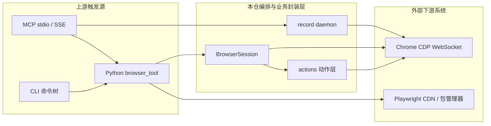

# 上下游集成与调用拓扑总览

本仓只有一个网络边界内的业务下游（Chrome DevTools Protocol）和一个一次性引导下游（Playwright CDN + 宿主包管理器）；录制 daemon 的 Unix socket 属于仓内进程边界。三者均登记出向字典契约专页，禁止只记 `CDPClient` 底座而漏掉业务封装层。

## 1. 上下游调用拓扑图

## 2. 仓内组件双向速查表

| 本仓组件 | 源码路径 | 直接上游调用方（符号 + 锚点） | 调用的仓内下游模块 | 调用的外部下游 | 架构页 |
|---|---|---|---|---|---|
| 无状态工具入口 | `src/octop_browser/tool_interface.py` | `_run_action` (`src/octop_browser/cli.py:523-525`)、`call_tool` (`src/octop_browser/mcp_server.py:475`) | `BrowserSession` | 经会话间接调用 Chrome | [`../architecture/api-and-mcp.md`](../architecture/api-and-mcp.md) |
| MCP 服务 | `src/octop_browser/mcp_server.py` | MCP 客户端 stdio / SSE | `browser_tool`、`RecordController`、`ReplayRunner` | 同上 + daemon | [`../architecture/api-and-mcp.md`](../architecture/api-and-mcp.md) |
| CLI | `src/octop_browser/cli.py` | 用户终端 | `browser_tool`、`ensure_chromium`、`send_request` | 同上 + CDN | [`../architecture/cli.md`](../architecture/cli.md) |
| 会话引擎 | `src/octop_browser/session.py` | `browser_tool` | `actions/*`、`CDPClient`、`launcher` | Chrome CDP | [`../architecture/browser-engine.md`](../architecture/browser-engine.md) |
| CDP 底座 | `src/octop_browser/cdp/client.py` | `BrowserSession`、`RecordSession` | `websockets` 库 | Chrome CDP | [`../architecture/cdp-layer.md`](../architecture/cdp-layer.md) |
| 进程启动器 | `src/octop_browser/cdp/launcher.py` | `_InternalCDPSession.connect` (`src/octop_browser/session.py:59-62`) | `launch_prep`、`aiohttp` | Chrome 进程 + HTTP 探测 | [`../architecture/cdp-layer.md`](../architecture/cdp-layer.md) |
| 安装引导 | `src/octop_browser/install.py` | CLI `install-browser`、MCP `install_browser` | `playwright_download`、`linux_deps` | Playwright CDN / 包管理器 | [`../architecture/install-bootstrap.md`](../architecture/install-bootstrap.md) |
| 录制 daemon | `src/octop_browser/record/daemon.py` | `_run_record` (`src/octop_browser/cli.py:542-598`)、MCP 录制工具 | `RecordController`、`RecordingStore` | Chrome CDP | [`../architecture/record-worker.md`](../architecture/record-worker.md) |

## 3. 外部下游依赖系统全量清单

| 下游系统 | 承担职责 | 协议与成功判定 | 底座（`路径:行号`） | 本仓业务封装文件（组装参数层） | 超时/重试配置 | 契约专页 |
|---|---|---|---|---|---|---|
| Chrome DevTools Protocol | 页面导航、DOM、输入、截图、标签管理 | WebSocket JSON-RPC；响应无 `error` 键即成功 | `CDPClient.send` (`src/octop_browser/cdp/client.py:75-116`) | `actions/navigate.py`、`actions/interact.py`、`actions/capture.py`、`actions/js_eval.py`、`session.py`、`dom/builder.py`、`cdp/launcher.py` | `cdp_timeout=30.0`；launcher 轮询 20×0.25s | [`downstream/chrome-cdp.md`](downstream/chrome-cdp.md) |
| Playwright CDN + 宿主包管理器 | 一次性下载 Chromium 二进制并补齐系统库/字体 | HTTP TTFB 探测 + 子进程返回码 0；最终由 `chrome --version` 门禁 | `install_chromium_stream` (`src/octop_browser/install.py:486-620`) | `src/octop_browser/playwright_download.py:46-148`、`src/octop_browser/linux_deps.py:220-285` | 探测 4s；验证 10s；`sudo -n` 不交互 | [`downstream/playwright-cdn.md`](downstream/playwright-cdn.md) |

仓内进程边界：录制 daemon 使用 `asyncio.start_unix_server` 监听 `daemon.sock`，CLI/MCP 通过 `send_request()` 发送单行 JSON（`src/octop_browser/record/daemon.py:107-129,140-165`）。它不跨仓、不对外暴露网络端口，故不列为外部下游。

## 4. 单仓依赖结论

本仓为单仓工作区，`repo_deps` 为空；README 中列出的 harness-agent / harness-memory / harness-gateway / Octop 是上层组合方，本仓源码内**未找到**对它们的调用边，不做跨仓依赖脑补。字段在入向与出向之间的变形规则见 [`topology-and-mapping.md`](topology-and-mapping.md)。
