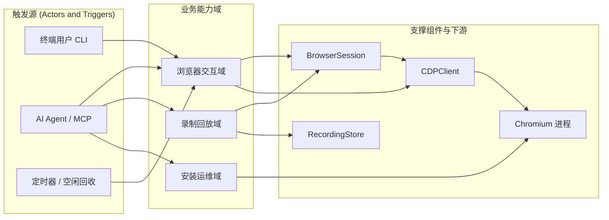

# 业务架构全景

本仓面向三类调用角色：终端用户（CLI，入口 `cli.main` 位于 `src/octop_browser/cli.py:631`）、AI Agent（Python API / MCP）、以及进程内定时器（空闲回收、录制目标轮询）。业务能力分三域：浏览器交互、录制回放、安装运维；三者共享 `browser_tool` 单一分发入口与 `ToolResult` 包络，端到端闭环为「装二进制 → 建会话 → 执行动作 → 录制 → 折叠为语义步骤 → 回放验证」。单仓模式，无跨仓协作。

## 1. 角色触发源与业务域拓扑

## 2. 业务域边界与能力矩阵

| 业务域标识 | 业务域名称 | 核心业务职责 | 核心状态实体 | 归属代码模块 | 核心准入 / 配额约束 | 关联业务清单 |
|---|---|---|---|---|---|---|
| `DOM-01` | 浏览器交互 | 通过纯 CDP 驱动真实 Chrome，产出 token 友好 DOM 与稳定 ref 交互 | `BrowserSession`、`RefCache`、`ToolResult` | `src/octop_browser/session.py`、`dom/`、`actions/`、`cdp/` | 需可用 Chromium 二进制；`cdp_ws_url` 非空时禁止切标签 | [业务总表](../business/index.md) |
| `DOM-02` | 录制回放 | 采集真实操作、折叠为语义步骤、按意图重放并验证 | `RecordingManifest`、`StepsDocument`、回放报告 | `src/octop_browser/record/` | 守护进程单活跃录制；事件 65536 字节 / 100 每秒限流 | [录制采集](../business/wf-record-capture.md) |
| `DOM-03` | 安装运维 | 一次性引导下载 Chromium 与 Linux 系统依赖 | Playwright 缓存二进制 | `src/octop_browser/install.py`、`linux_deps.py`、`playwright_download.py` | `OCTOP_SKIP_PLAYWRIGHT_PIP` 可跳过 pip；系统依赖失败不阻断验证 | [安装引导](../business/wf-chromium-install.md) |

## 3. 全量业务流程主索引（`WF-*`）

| 流程 ID | 流程名称 | 触发入口（`路径:行号`） | 串联组件与下游（按执行序） | 关键状态迁移 | 流程专页 |
|---|---|---|---|---|---|
| `WF-01` | 会话创建、连接与关闭 | `BrowserSession.create` (`src/octop_browser/session.py:198`) | `browser_tool → ProfileManager → launch_or_attach → CDPClient → Chrome` | `detached → connected → detached/reaped` | [wf-browser-session-lifecycle.md](../business/wf-browser-session-lifecycle.md) |
| `WF-02` | 单动作分发与归一化 | `browser_tool` (`src/octop_browser/tool_interface.py:91`) | `CLI/MCP → _registry → getattr → ToolResult → hooks` | `ToolResult(success)` | [wf-action-dispatch.md](../business/wf-action-dispatch.md) |
| `WF-03` | DOM 快照、ref 签发与交互 | `BrowserSession.dom_tree` (`src/octop_browser/session.py:300`) | `DOM.getDocument → DOMBuilder → RefCache → Input.dispatch*` | `RefCache._refs` 填充 / 失效 | [wf-dom-ref-targeting.md](../business/wf-dom-ref-targeting.md) |
| `WF-04` | 录制采集与隐私脱敏 | `RecordController.start_in_process` (`src/octop_browser/record/recorder.py:350`) | `daemon IPC → 注入 JS → bindingCalled → redact_event → events.jsonl` | `recording → stopped` | [wf-record-capture.md](../business/wf-record-capture.md) |
| `WF-05` | 语义折叠与变量推断 | `SemanticProcessor.process` (`src/octop_browser/record/semantic.py:338`) | `read_events → 过滤 → 折叠 → 变量化 → steps.json` | `events → steps/inputs/verification` | [wf-semantic-steps.md](../business/wf-semantic-steps.md) |
| `WF-06` | 回放、目标匹配与报告 | `ReplayRunner.run` (`src/octop_browser/record/replay.py:25`) | `read_steps → browser_tool → match_target → verification → 报告` | `running → passed/failed` | [wf-replay.md](../business/wf-replay.md) |
| `WF-07` | Chromium 安装引导 | `ensure_chromium` (`src/octop_browser/install.py:280`) | `pip → CDN 竞速 → playwright install → install-deps → chrome --version` | 二进制存在且可运行 | [wf-chromium-install.md](../business/wf-chromium-install.md) |
| `WF-08` | 标签管理与目标粘性 | `BrowserSession.new_tab` (`src/octop_browser/session.py:563`) | `Target.createTarget → switch_to_target → /json → save_target` | 粘性 `target_id` | [wf-tab-management.md](../business/wf-tab-management.md) |

## 4. 全局业务不变量（不可破坏的业务红线）

1. **动作白名单与统一返回不变量**：动作名必须落在 `_KNOWN_ACTIONS`（20 项），任何失败必须包成 `ToolResult(success=False)` 而非裸抛 —— 校验锚点 `src/octop_browser/tool_interface.py:20`、`:211`。
2. **ref 导航失效不变量**：任何跨文档导航必须清空 `RefCache`，否则把过期 `nodeId` 交给 Agent —— 校验锚点 `src/octop_browser/actions/navigate.py:28`、`src/octop_browser/session.py:141`。
3. **登录态归属不变量**：同一 `profile` 名固定映射同一 `--user-data-dir`，禁止为 cookie/auth 另造路径 —— 校验锚点 `src/octop_browser/profile.py:169`。
4. **录制隐私不变量**：事件写盘前一律经 `redact_event`，敏感值替换为 `{{sensitive_value}}` —— 校验锚点 `src/octop_browser/record/recorder.py:248`、`src/octop_browser/record/privacy.py:79`。
5. **回放语义不变量**：回放只按 `match_target` 打分匹配当前页面元素，不复用录制期 `ref`/坐标 —— 校验锚点 `src/octop_browser/record/replay.py:112`、`src/octop_browser/record/matcher.py:19`。
6. **凭据安全不变量**：无密钥明文落库、不回显、不写日志；`PYPI_TOKEN` 仅用于发布目标且未打印 —— 校验锚点 `Makefile:21`、`src/octop_browser/record/privacy.py:35`。

## 5. 共变耦合与修改清单（Agent Co-Change Playbook）

- **新增业务域**：本页第 2、3 节、[业务能力总表](../business/index.md)、[主干调用链全景](callchain-panorama.md) 与根级 [INDEX](../INDEX.md) 的意图路由同步。
- **修改 `WF-*` 入口**：各流程专页、[业务总表](../business/index.md)、[入向接口契约全集](../contracts/api-reference.md) 与 `.wiki-meta.json` 的 `moduleTree` 联动。
- **修改不变量**：对应校验锚点源码与 [高危雷区](../operations/pitfalls-and-adr.md) 的 ADR 表一起改，并跑全量 `pytest tests/unit/`，命令见 [构建与单测映射](../operations/dev-and-test.md)。
