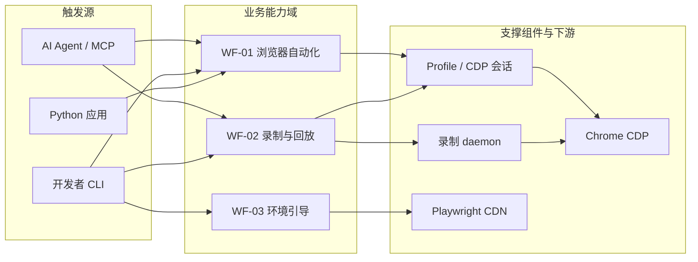

# 业务架构全景

本仓面向三类触发角色：AI Agent（通过工具或 MCP）、开发者/SRE（通过 CLI）、组合方应用（通过 Python API）。三条业务闭环分别是「无状态工具调用」「录制到 Skill 引导回放」「浏览器引导安装」，全部围绕「一个命名 profile = 一个持久浏览器身份」这一核心抽象。

## 1. 角色触发源与业务域拓扑

## 2. 业务域边界与能力矩阵

| 业务域标识 | 业务域名称 | 核心业务职责 | 核心状态实体 | 归属代码模块 | 关键准入约束 | 关联清单 |
|---|---|---|---|---|---|---|
| `DOM-01` | 浏览器自动化 | 导航、DOM 读取、交互、截图、标签管理 | `ToolResult`、`RefCache`、`Profile` | `session.py`、`actions/`、`dom/` | 动作必须在 19 项白名单内；ref 来自实时快照 | [`../business/index.md`](../business/index.md) |
| `DOM-02` | 录制与回放 | 录制真实浏览、折叠语义步骤、生成 Skill、按意图重放 | `RecordingManifest`、`StepsDocument`、`SemanticStep` | `record/` | 单一活动录制；落盘前脱敏；回放重匹配 | [`../business/wf-record-replay.md`](../business/wf-record-replay.md) |
| `DOM-03` | 环境引导 | 下载 Chromium、补系统库/字体、验证可运行 | `InstallEvent`、Playwright 缓存 | `install.py`、`linux_deps.py` | 以 `chrome --version` 为唯一成功门禁 | [`../business/wf-chromium-bootstrap.md`](../business/wf-chromium-bootstrap.md) |

## 3. 全量业务流程主索引（`WF-*`）

| 流程 ID | 流程名称 | 触发入口（`路径:行号`） | 串联组件与下游（按执行序） | 关键状态迁移 | 专页 |
|---|---|---|---|---|---|
| `WF-01` | 无状态工具调用与会话复用 | `browser_tool` (`src/octop_browser/tool_interface.py:91`)、CLI `_run_action` (`src/octop_browser/cli.py:514`)、MCP `call_tool` (`src/octop_browser/mcp_server.py:392`) | `入向 → _registry → BrowserSession → actions → CDP → Chrome` | 未创建 → connected → reused / detached / reaped | [`../business/wf-browser-action.md`](../business/wf-browser-action.md) |
| `WF-02` | 录制、语义折叠与 Skill 引导回放 | `RecordController.start_in_process` (`src/octop_browser/record/recorder.py:350`)、`ReplayRunner.run` (`src/octop_browser/record/replay.py:25`) | `daemon → 注入 JS → events.jsonl → SemanticProcessor → SkillGenerator / ReplayRunner → CDP` | recording → stopped → replaying → passed/failed | [`../business/wf-record-replay.md`](../business/wf-record-replay.md) |
| `WF-03` | Chromium 引导安装与验证 | `ensure_chromium` (`src/octop_browser/install.py:280`)、`install_chromium_stream` (`:486`) | `pip → CDN 竞速 → 下载 → 系统库/字体 → verify` | checking → downloading → installing_deps → verified/failed | [`../business/wf-chromium-bootstrap.md`](../business/wf-chromium-bootstrap.md) |

## 4. 全局业务不变量

1. **会话按 profile 隔离**：同一 profile 复用 `_registry` 会话与 CDP 端口；不同 profile 各自独立目录（`src/octop_browser/tool_interface.py:63-68`、`src/octop_browser/profile.py:165-174`）。
2. **导航即失效**：四个导航动作第一步都清 `RefCache`（`src/octop_browser/actions/navigate.py:28,63,73,83`）。
3. **敏感信息不落盘**：事件在 append 前必过 `redact_event()`，敏感值写 `{{sensitive_value}}`（`src/octop_browser/record/recorder.py:248-249`、`src/octop_browser/record/privacy.py:74-81`）。
4. **回放意图而非坐标**：`match_target()` 对当次 structured DOM 重打分，阈值 45（`src/octop_browser/record/matcher.py:60-62`）。
5. **安装以验证为准**：下载与装库失败都不直接宣布成功，必须 `verify_chromium()` 返回 True（`src/octop_browser/install.py:364-369`）。
6. **事件速率与体积上限**：单条 65536 字节、每秒 100 条，超限静默丢弃（`src/octop_browser/record/settings.py:30-35`）。

## 5. 共变耦合与修改清单

- 新增业务域：在 `../business/index.md` 增加 `WF-*` 行并新建流程专页，同时更新本页拓扑与 `../INDEX.md` 路由表。
- 改任一不变量：必须同步对应流程页的「精确阈值」表与 `../contracts/error-codes.md` 的降级标识。
- 改 profile 抽象：影响三域全部流程，跑 `tests/unit/test_profile.py` 与三域相关单测。
- 改脱敏策略：Python 与注入 JS 两处正则必须一致（`src/octop_browser/record/privacy.py:11-24`、`src/octop_browser/record/injected/recorder.js:13-17`）。
