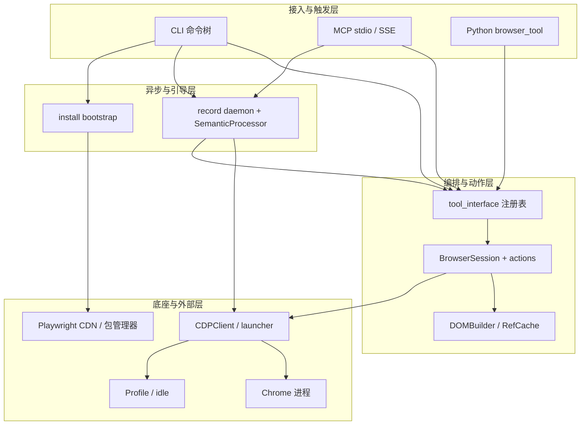

# 系统技术架构

本仓是同进程 Python 包：三种入口（CLI / MCP / Python API）汇入无状态工具层，再由 `BrowserSession` 编排动作与 DOM，经纯 CDP WebSocket 驱动独立的 Chrome 子进程；录制 daemon 是唯一常驻的辅助进程。所有状态落在 profile 与录制目录，不依赖服务端。

## 1. 运行时分层与依赖拓扑



| 架构层 | 包含目录/文件 | 核心职责 | 越界禁令 |
|---|---|---|---|
| 接入与触发层 | `src/octop_browser/cli.py`、`mcp_server.py`、`tool_interface.py` | 协议解析、动作白名单、profile 路由、退出码/错误回显 | 禁止在入口层直接拼 CDP 字典 |
| 编排与动作层 | `session.py`、`actions/`、`dom/`、`hooks.py`、`models.py` | 动作洋葱链、四档 DOM、ref 生命周期、指标累计 | 禁止耦合 CLI/MCP 框架对象 |
| 异步与引导层 | `record/`、`install.py`、`playwright_download.py`、`linux_deps.py` | 录制 daemon、语义折叠、Skill 生成、安装门禁 | 安装引导不得成为运行时依赖 |
| 底座与外部层 | `cdp/`、`profile.py`、`idle.py`、`settings.py` | WebSocket 帧、进程生命周期、配置与状态目录 | 外部 host 一律走配置项，禁止硬编码 |

## 2. 进程启动装配与停机序列

```text
src/octop_browser/cli.py:631 main()
  ├─ [1. config] logging.basicConfig + argparse 解析 -> :633-635
  ├─ [2. dispatch] install / record / replay / 动作四分支 -> :637-649
  └─ 动作分支 -> browser_tool() -> BrowserSession.create() -> src/octop_browser/session.py:198-250
       ├─ ProfileManager.get_or_create(profile) -> 目录与端口 : :228
       ├─ 模式解析 headless > mode > cfg.browser_mode : :231-235
       ├─ _InternalCDPSession.connect() -> launch_or_attach / 直连 WS : :49-72（CDP 帧封装 `src/octop_browser/cdp/client.py:75-116`）
       ├─ enable Page/DOM/Runtime + viewport override : :63-69
       └─ idle controller start（仅本机且 timeout>0） : :71-72

src/octop_browser/mcp_server.py:482 _main()
  ├─ MCP_PORT 未设 -> stdio_server -> app.run : :526-530
  └─ MCP_PORT 设置 -> uvicorn + Starlette(/sse,/messages/) : :491-525

src/octop_browser/record/recorder.py:350 RecordController.start_in_process()
  └─ 建 RecordingManifest + RecordSession.start() 注入 JS : :350-395

src/octop_browser/install.py:280 ensure_chromium()
  └─ pip 引导 -> CDN 竞速 -> 系统库 -> verify_chromium 门禁 : :280-369

停机：session.close(kill=False) 仅断 CDP；kill=True 走 idle.reap_now 或 terminate_browser
  src/octop_browser/session.py:149-163、src/octop_browser/cdp/launcher.py:440-494
```

录制 daemon 独立进程：`start_daemon_process()` 用 `Popen([sys.executable, "-m", "octop_browser.record.daemon"], start_new_session=True)` 拉起（`src/octop_browser/record/daemon.py:176-187`），`RecordDaemon.run()` 监听 Unix socket 并写 pid 文件（`:107-129`）。

## 3. 跨切面工程机制速查表

| 机制维度 | 核心符号与源码锚点 | 全局实现规则 |
|---|---|---|
| 认证鉴权与租户隔离 | `profile` 字符串 (`src/octop_browser/tool_interface.py:63-68`) | 无用户鉴权；以 profile 名隔离 CDP 端口与 user-data-dir，MCP SSE 无内建鉴权 |
| 并发、锁与线程卸载 | `_registry` (`src/octop_browser/tool_interface.py:17`)、`asyncio.to_thread` (`src/octop_browser/cdp/launcher.py:490,493`) | 事件循环单线程串行；阻塞的 `pkill`/shutil 操作卸载到线程池 |
| 缓存与指纹失效 | `RefCache.invalidate` (`src/octop_browser/dom/refs.py:23-25`)、`_USER_NS_CACHE` (`src/octop_browser/cdp/launcher.py:312-347`) | 导航清 ref；namespace 探测结果进程内缓存 |
| 异常到协议状态映射 | `_error_result` (`src/octop_browser/tool_interface.py:46-54`)、`_format_result` (`src/octop_browser/cli.py:502-511`) | 异常转 `success=False`，CLI 退出码 1，MCP 文本前缀 `ERROR:` |
| 外部边界与默认降级 | `cfg.cdp_ws_url` (`src/octop_browser/session.py:55-57`)、`RecordingStore` (`src/octop_browser/record/store.py:14-19`) | 直连 WS 跳过 launcher；无 daemon 时录制命令回传可操作错误 |
| 配置与单例 | `OctopSettings` (`src/octop_browser/settings.py:109-185`) | 每次实例化重读环境；单例仅 import 时读取 |

## 4. 共变耦合与修改清单

- 改分层边界：同步 [`../architecture/index.md`](../architecture/index.md) 组件矩阵与 [`../architecture/module-dep-matrix.md`](../architecture/module-dep-matrix.md) 依赖边。
- 改启动序列：核对 idle controller 启动时机（`src/octop_browser/session.py:71-72`）与停机 kill 分支，跑 `tests/unit/test_idle.py`。
- 改 MCP 传输：涉及对外网络暴露面，同步 [`../contracts/configuration.md`](../contracts/configuration.md) 与 [`../operations/boundary.md`](../operations/boundary.md)。
- 新增入口协议：必须在 `tool_interface` 层汇合，禁止绕开动作白名单直接调 `BrowserSession`。
