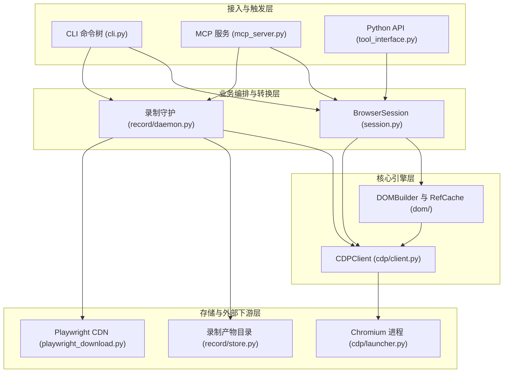

# 系统技术架构

本仓是以 Python 3.11+ 编写的**单进程短命 CLI + MCP 服务 + 可独立守护进程**组合，核心技术栈为 `websockets` 手写 CDP 客户端、`aiohttp` HTTP 探测、`pydantic` 值对象与 `mcp` SDK。分层原则：接入层只做协议解析与参数翻译，编排层按 `profile` 复用会话，核心引擎层持有 CDP WebSocket 与 DOM ref 缓存，存储与适配层负责 Chrome 进程、磁盘状态与下游协议发送；在线动作与录制采集共享同一传输底座但互不污染状态。

## 1. 运行时分层与依赖拓扑



| 架构层 | 包含目录 / 文件 | 核心职责 | 越界禁令（Agent 修改红线） |
|---|---|---|---|
| 接入与触发层 | `src/octop_browser/cli.py`、`mcp_server.py`、`tool_interface.py` | argparse 命令树、MCP 工具注册、无状态动作分发 | 禁止直接拼装 CDP `params` 字典或写盘 |
| 业务编排层 | `src/octop_browser/session.py`、`hooks.py`、`models.py` | 会话生命周期、hooks、`ToolResult` 归一化、指标累计 | 禁止耦合具体外部 SDK 对象 |
| 核心引擎层 | `src/octop_browser/dom/`、`actions/`、`cdp/client.py` | 四档 DOM、稳定 ref、CDP 帧封装与事件分发 | 禁止假设 `localhost`，主机一律取 `cfg.cdp_host` |
| 存储与适配层 | `src/octop_browser/cdp/launcher.py`、`launch_prep.py`、`profile.py`、`record/store.py`、`settings.py` | Chrome 拉起/附着、profile 端口与目标粘性、磁盘产物、环境解析 | 外部地址与凭据一律走配置项，禁止硬编码 |
| 录制回放层 | `src/octop_browser/record/` | 注入采集、语义折叠、回放、skill 生成、守护 IPC | 禁止把旧 `ref`/坐标写进 `steps.json` |

## 2. 进程启动装配与停机序列（Bootstrap Call Tree）

```text
入口 1: octop-browser <cmd> -> cli.main (src/octop_browser/cli.py:631)
  ├─ [1. parse] _build_parser() 注册 24 顶层命令 + 11 子命令 (src/octop_browser/cli.py:96)
  ├─ [2. branch] install-browser / record / replay / _run_action (src/octop_browser/cli.py:637)
  └─ [3. run] asyncio.run(...) 每进程一次，退出后 Chrome 因 start_new_session 存活

入口 2: python -m octop_browser.mcp_server -> _main (src/octop_browser/mcp_server.py:482)
  ├─ [1. config] mcp_port = os.environ.get("MCP_PORT") (:491)
  ├─ [2. routers] MCP_PORT 非空 -> Starlette 注册 GET /sse 与 POST /messages/ (:513)
  │    └─ uvicorn.Config(host=MCP_HOST, port=MCP_PORT, log_level="info").serve() (:520)
  └─ [3. stdio] 否则 stdio_server() -> app.run(read, write, create_initialization_options()) (:527)

会话装配: browser_tool 首次按 profile 调用 (src/octop_browser/tool_interface.py:91)
  ├─ [1. config] cfg = settings or _default_settings (src/octop_browser/session.py:226)
  ├─ [2. profile] ProfileManager.get_or_create -> data_dir + cdp_port (src/octop_browser/profile.py:165)
  ├─ [3. mode] headless 显式 > mode 参数 > cfg.browser_mode (src/octop_browser/session.py:231)
  ├─ [4. connect] _InternalCDPSession.connect：直连 WS 或 launch_or_attach + get_page_ws_url (:49)
  ├─ [5. domains] enable_domain Page/DOM/Runtime + _apply_viewport (:64、:74)
  ├─ [6. idle] idle_controller.start()（仅本地 host 且 timeout>0）(:71)
  └─ [7. shutdown] close(kill=False) 只断 WS；kill=True 追加 terminate_browser (:887、:149)
```

## 3. 跨切面工程机制速查表

| 机制维度 | 核心符号与源码锚点 | 全局实现规则 |
|---|---|---|
| 认证鉴权与租户隔离 | `ProfileManager.get_or_create`（`src/octop_browser/profile.py:165`） | 无登录态校验；`profile` 名隔离独立 user-data-dir，无 admin 豁免 |
| 并发、锁与线程卸载 | `_registry`（`src/octop_browser/tool_interface.py:17`）、`asyncio.create_task`（`src/octop_browser/cdp/client.py:72`） | 事件循环单线程无显式锁；接收循环与 `RecordSession._poll_targets` 为后台任务 |
| 缓存与 ref 失效 | `RefCache.invalidate`（`src/octop_browser/dom/refs.py:23`） | 导航类动作必清空；跨进程粘性靠 `.octop-browser-target.json`（`src/octop_browser/profile.py:24`） |
| 异常到协议状态映射 | `_error_result`（`src/octop_browser/tool_interface.py:46`）、`_record`（`src/octop_browser/session.py:895`） | 失败统一 `ToolResult(success=False)`；hooks 回调异常被吞并记日志（`src/octop_browser/hooks.py:52`） |
| 外部边界与默认降级 | `send_request`（`src/octop_browser/record/daemon.py:140`）、`race_download_sources`（`src/octop_browser/playwright_download.py:108`） | 守护不可达返回 `ok=False`；CDN 全探测失败回落 catalog 顺序，不虚构成功 |
| 配置与环境 | `OctopSettings`（`src/octop_browser/settings.py:110`） | 每字段 `default_factory` 重读环境；模块级 `settings` 单例仅 import 时构造（`:185`） |
| 安装器 | `ensure_chromium`（`src/octop_browser/install.py:280`） | Playwright 仅作一次性下载器，不进入运行时动作链 |

## 4. 共变耦合与修改清单（Agent Co-Change Playbook）

- **新增接入方式**：`__all__`（`src/octop_browser/__init__.py:15`）、[入向接口契约全集](../contracts/api-reference.md)、[组件技术架构总表](../architecture/index.md) 与本页拓扑图联动。
- **修改分层边界**：若把 CDP `params` 拼装上移到接入层，需同步 [Chrome CDP 契约](../integrations/downstream/chrome-cdp.md) 的字典表与 [参数组装映射](../integrations/topology-and-mapping.md)。
- **修改会话装配**：`BrowserSession.create`（`src/octop_browser/session.py:198`）与 `_InternalCDPSession.connect`（`:49`）成对核查，并跑 `pytest tests/integration/test_session.py`，命令见 [构建与单测映射](../operations/dev-and-test.md)。
